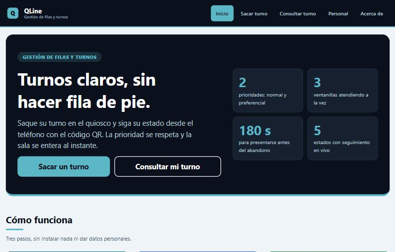
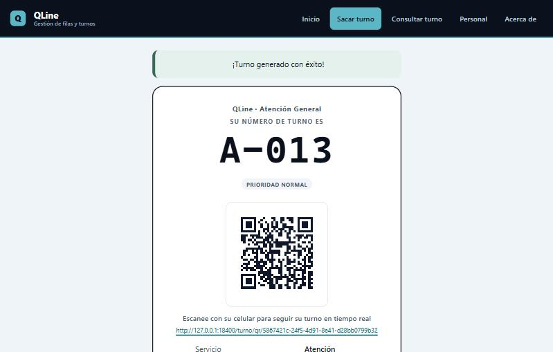
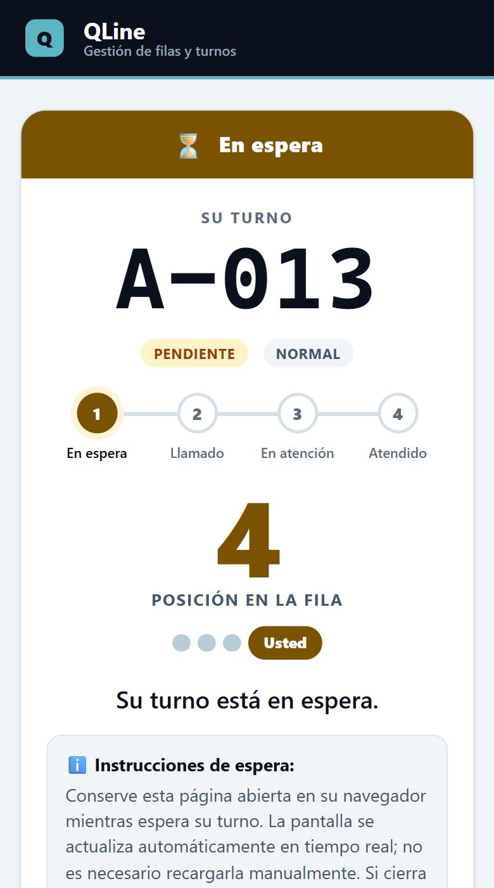
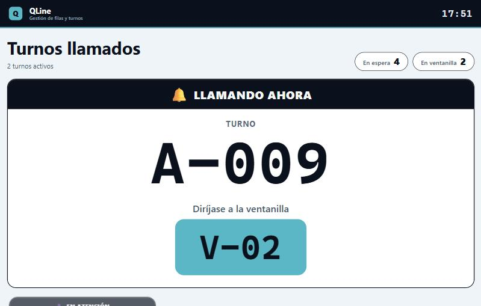
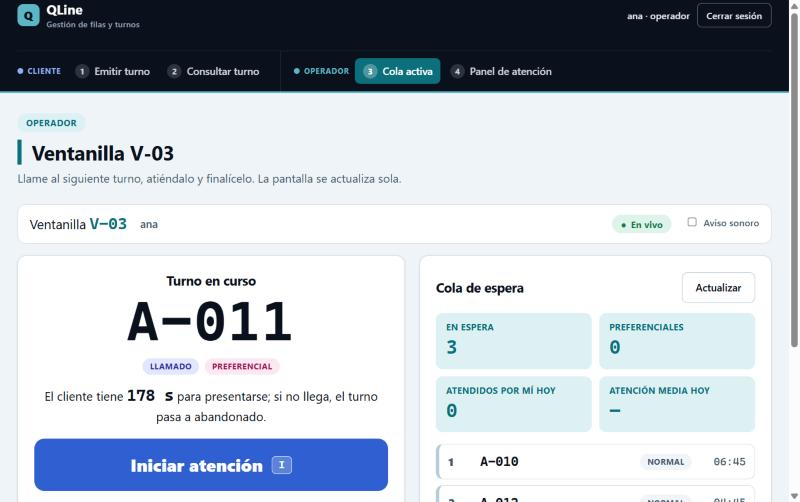
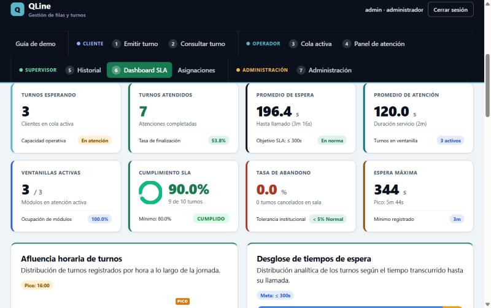
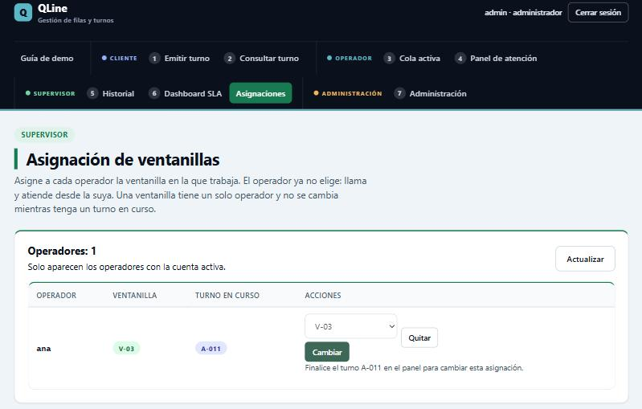
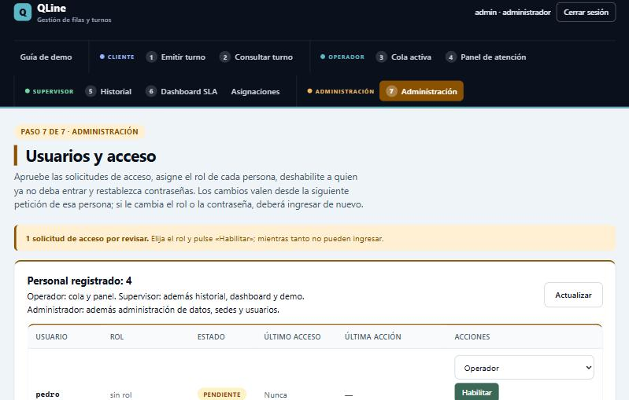
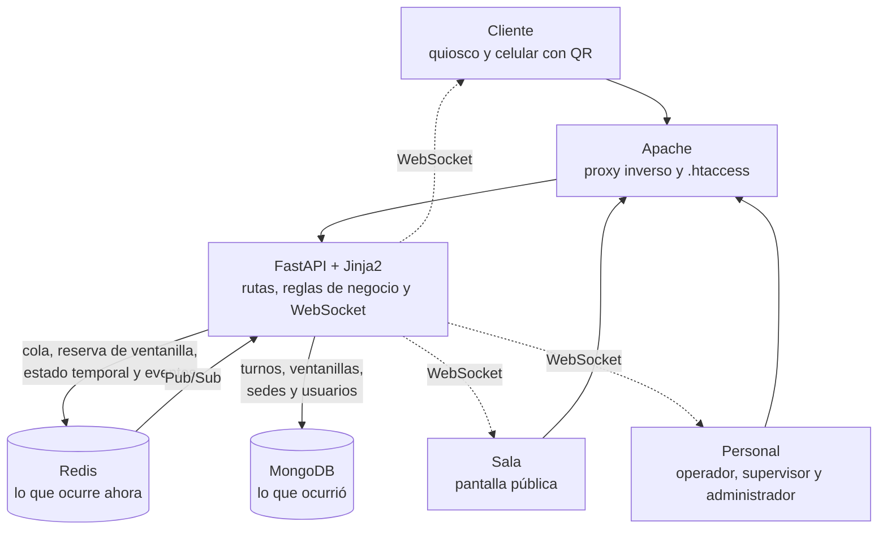

# QLine

**Sistema de gestión de filas y turnos en tiempo real**

> *«MongoDB conserva lo que ocurrió. Redis controla lo que ocurre ahora.»*

QLine reemplaza la fila de pie por un turno digital: el cliente lo saca en un quiosco, sigue su posición desde el celular con un código QR, un operador lo llama desde su ventanilla y una pantalla de sala lo anuncia. Cada paso queda registrado para el historial y los indicadores de servicio. No guarda datos personales del cliente.

Proyecto final de **Tópicos Avanzados de Bases de Datos** · Universidad Nacional · Equipo **Query Logic** (Grupo 2)


| | |
|---|---|
| **Aplicación desplegada** | <https://grupo2.crnube.net/proyecto/qline/> (pide las credenciales de prueba que van en el PDF de entrega) |
| **Documentación** | [Arquitectura](docs/arquitectura/arquitectura.md) · [Decisiones técnicas](docs/decisiones.md) · [Evidencia de pruebas](docs/evidencia/README.md) · [Cambios](CHANGELOG.md) |

## Contenido

1. [El problema y la solución](#el-problema-y-la-solución)
2. [Capturas](#capturas)
3. [Quién usa QLine](#quién-usa-qline)
4. [Funcionalidades](#funcionalidades)
5. [Arquitectura](#arquitectura)
6. [Instalación paso a paso](#instalación-paso-a-paso)
7. [Variables de entorno](#variables-de-entorno)
8. [Datos de prueba](#datos-de-prueba)
9. [Uso](#uso)
10. [Pruebas y mediciones](#pruebas-y-mediciones)
11. [Seguridad y privacidad](#seguridad-y-privacidad)
12. [Documentación](#documentación)
13. [Roadmap](#roadmap)
14. [Equipo](#equipo)
15. [Licencia](#licencia)

## El problema y la solución

En una oficina con atención al público la fila física tiene tres problemas: nadie sabe cuánto va a esperar, la prioridad (adultos mayores, personas con discapacidad, embarazadas) depende de la buena voluntad de quien atiende, y a la institución no le queda ningún dato de cuánto tardó cada atención.

QLine lo resuelve con un flujo simple:

1. El cliente saca un turno **normal** o **preferencial** en el quiosco y recibe un ticket con un código QR.
2. Desde el celular ve su posición y su estado, sin instalar nada y sin dar datos personales.
3. Un operador llama al siguiente desde su ventanilla: **primero los preferenciales y, dentro de cada grupo, por orden de llegada**.
4. Una pantalla de sala anuncia el turno llamado y la ventanilla.
5. Si el cliente no se presenta en **180 segundos**, el turno pasa solo a `abandonado` y la ventanilla queda libre.
6. El supervisor consulta el historial y el nivel de servicio (esperas, abandonos y cumplimiento del objetivo).

**Reglas que el sistema garantiza:** una ventanilla atiende un turno a la vez y dos ventanillas nunca reciben el mismo turno, ni siquiera con solicitudes simultáneas.

## Capturas

| | |
|:--:|:--:|
|  |  |
| **Portada** | **Ticket con código QR** |
|  |  |
| **Seguimiento del turno en el celular** | **Pantalla de sala** |
|  |  |
| **Vista de trabajo del operador** | **Dashboard y SLA del supervisor** |
|  |  |
| **Asignación de ventanillas** | **Usuarios y acceso (administrador)** |

*Capturas tomadas con datos de demostración sintéticos.*

## Quién usa QLine

| Usuario | Necesita iniciar sesión | Qué hace |
|---|---|---|
| **Cliente** | No | Saca su turno en el quiosco, sigue su estado desde el celular con el QR y consulta un turno por código |
| **Sala** (pantalla pública) | No | Muestra los turnos llamados y en atención |
| **Operador** | Sí | Trabaja en **su** ventanilla, que le asigna el supervisor: llama, inicia y finaliza la atención |
| **Supervisor** | Sí | Además, ve el panel de todas las ventanillas, el historial y el dashboard, y asigna ventanillas a los operadores |
| **Administrador** | Sí | Además, administra usuarios, ventanillas, sedes y los datos |

El personal solicita acceso en `/registro`; la solicitud queda pendiente hasta que el administrador la habilita y le asigna un rol. El nombre de usuario lleva solo letras (de la A a la Z, 3 a 30).

## Funcionalidades

- **Cola con prioridad** y asignación atómica: ningún turno se entrega dos veces.
- **Seguimiento en vivo** en el celular, la sala y la vista del operador, por WebSocket con consulta periódica como respaldo.
- **Abandono automático** a los 180 s y liberación de la ventanilla.
- **Cierre de la atención** con un motivo de una lista cerrada y una nota opcional de hasta 200 caracteres.
- **Vista del operador** con el turno en curso, la cola con la espera de cada turno, aviso de turnos preferenciales y atajos de teclado.
- **Historial y dashboard** con filtros, desglose por fecha, indicadores de servicio (SLA) y descarga en JSON.
- **Ventanillas configurables** que se dan de alta y de baja sin tocar el código.
- **Inicio de sesión por rol**, con contraseñas almacenadas solo como hash, y administración de usuarios.
- **Recuperación:** si Redis pierde la cola, se reconstruye desde MongoDB.
- **Estado de salud** en `/salud` (aplicación, Redis y MongoDB), sin datos de infraestructura.
- **Extra del trabajo:** mantenimiento de sedes (RFC-004), que cataloga sedes y aprovisiona sus ventanillas. **No vuelve multisucursal al sistema**: la operación sigue siendo de un solo servicio y una sola sede.

## Arquitectura

Dos motores de datos con una función clara cada uno, detrás de una aplicación FastAPI:



| Motor | Qué dato vive ahí | Por qué |
|---|---|---|
| **Redis** | La cola con prioridad (Sorted Set), la reserva de cada ventanilla (`SET NX`), el estado temporal del turno llamado (Hash con TTL de 180 s) y el canal de eventos (Pub/Sub) | `ZPOPMIN` entrega el siguiente turno de forma **atómica** y el TTL cuenta solo el tiempo para presentarse |
| **MongoDB** | El turno y toda su historia (estados, marcas de tiempo, métricas, cierre), las cuentas del personal y los catálogos | Es la **fuente de verdad**: valida con `$jsonSchema`, indexa y calcula los indicadores con *aggregation pipelines* |

| Si falla… | QLine… |
|---|---|
| **Redis** | Responde 503 controlado sin dejar turnos a medias; el panel y la consulta por QR siguen con lo que conserva MongoDB; la cola se reconstruye después con `python -m scripts.rehidratar_cola` |
| **MongoDB** | El turno que se había extraído vuelve a la cola y las operaciones responden 503 con un mensaje claro, nunca un error interno |
| **El WebSocket** | Cada pantalla consulta su API cada pocos segundos, sin que nadie recargue |

El detalle completo (diagrama de flujos, modelo de datos, consistencia entre motores y mediciones) está en [`docs/arquitectura/arquitectura.md`](docs/arquitectura/arquitectura.md); el mapa de claves y canales de Redis, en [`docs/arquitectura/redis_claves.md`](docs/arquitectura/redis_claves.md).

**Tecnologías:** Python 3.12 · FastAPI · Jinja2 · MongoDB (PyMongo) · Redis (redis-py) · WebSocket · Apache como proxy inverso.

## Instalación paso a paso

**Requisitos**

- **Python 3.12** o superior.
- **MongoDB** con un usuario y una base de datos propios (por defecto `grupo2_db`).
- **Redis 7**. La aplicación no usa `CONFIG SET` ni `EVAL`, y tiene prohibido `FLUSHALL` y `FLUSHDB`.
- Para publicar en un servidor: **Apache** con `mod_rewrite` y `mod_proxy_http`/`mod_proxy_wstunnel`, y que el hosting permita `AllowOverride` de autenticación y `FileInfo`.
- Un celular para probar el QR (opcional).

**1. Descargar e instalar las dependencias**

```bash
git clone https://github.com/CaEsPi9713/Qline.git
cd Qline
python -m venv venv
source venv/bin/activate            # en Windows: venv\Scripts\activate
pip install -r requirements.txt
```

> **Si `python -m venv` termina con «ensurepip is not available»** (pasa en Debian y Ubuntu sin el paquete `python3-venv`, por ejemplo en un hosting de Virtualmin donde no se tienen permisos de administrador), no hace falta instalar nada con `apt`: cree el entorno sin `pip` y descárguelo dentro de él.
>
> ```bash
> python3 -m venv --without-pip venv
> source venv/bin/activate
> curl -sS https://bootstrap.pypa.io/get-pip.py -o get-pip.py
> python get-pip.py
> rm get-pip.py
> pip install -r requirements.txt
> ```
>
> Si ya existe un entorno con `pip` (por ejemplo el de una instalación anterior), otra salida es `pip install virtualenv` y luego `python -m virtualenv venv`. Si `python -m venv` falló a medias, borre la carpeta `venv` incompleta antes de repetirlo.

**2. Configurar el entorno**

```bash
cp .env.example .env
```

Edite `.env` con los datos de su MongoDB y su Redis y ponga un `SECRETO_SESION` propio (ver [Variables de entorno](#variables-de-entorno)). **Nunca** suba el `.env` al repositorio.

**3. Preparar MongoDB y cargar datos**

```bash
python scripts/init_mongo.py                          # esquema, índices y prueba de integridad
python scripts/generar_datos_sinteticos.py --cargar   # historial sintético para el dashboard
```

**4. Crear al primer administrador**

```bash
python -m scripts.crear_admin --usuario administrador   # pide la contraseña dos veces, sin mostrarla
```

El nombre de usuario lleva solo letras. Con `--restablecer` se cambia la contraseña de un administrador que ya existe.

Para una demostración, `python -m scripts.crear_usuarios_demo` crea los tres roles (`administrador`, `supervisor` y `operador`, este último con la ventanilla `V-01` asignada) con contraseñas generadas al azar, que se muestran **una sola vez** y no se guardan en ningún archivo; es idempotente y no pisa cuentas existentes.

**5. Ejecutar la aplicación**

```bash
uvicorn app.main:app --port 8000
```

Abra `http://127.0.0.1:8000/` e ingrese en `/login`. Con `BASE_PATH` vacío la aplicación se publica en la raíz; en el servidor del curso va bajo `/proyecto/qline`.

**6. Recorrer el flujo completo**

1. Solicite el acceso de un operador en `/registro` (sin iniciar sesión) y, como administrador, apruébelo en `/admin/usuarios`.
2. En `/supervisor/asignaciones` asígnele una ventanilla.
3. Saque un turno en `/quiosco`, escanee el QR o abra el enlace del ticket.
4. Ingrese como operador: en `/cola` llame al siguiente, inicie y finalice la atención.
5. Mire `/pantalla` (sala) y `/dashboard` (supervisor). La guía `/demo` lista el recorrido completo.

**7. Comprobar que todo quedó bien**

```bash
python -m scripts.preparar_demo [--cargar-sinteticos] [--en-espera N]   # comprueba y prepara la demostración; no borra nada
python -m unittest discover -s tests -t .                                # suite automática (requiere requirements-dev.txt)
```

**Servidor** (gunicorn detrás de Apache): [`qline.service`](qline.service) es el ejemplo de unidad de systemd (`gunicorn app.main:app -k uvicorn.workers.UvicornWorker`). El puerto de gunicorn **debe coincidir** con el de las reglas de proxy del [`.htaccess`](.htaccess); revíselo al desplegar.

## Variables de entorno

Se leen del archivo `.env` (copia de [`.env.example`](.env.example)).

| Variable | Para qué sirve | Valor por defecto / ejemplo |
|---|---|---|
| `MONGO_USER`, `MONGO_PASS` | Usuario y contraseña de MongoDB | los de su cuenta (el ejemplo trae marcadores) |
| `MONGO_DB` | Base de datos | `grupo2_db` |
| `MONGO_HOST`, `MONGO_PORT` | Servidor de MongoDB | `127.0.0.1`, `27017` |
| `REDIS_HOST`, `REDIS_PORT` | Servidor de Redis | `127.0.0.1`, `6379` |
| `REDIS_PASS` | Contraseña de Redis; vacía si no la pide | vacía |
| `BASE_PATH` | Subruta bajo la que Apache publica la aplicación | `/proyecto/qline` en el servidor del curso; vacía al ejecutar en la raíz |
| `PUBLIC_BASE_URL` | Dominio público de los enlaces del QR. Debe abrirse desde un celular: **nunca `localhost`** | `https://grupo2.crnube.net` |
| `BARRIDO_ABANDONO` | `1` (o ausente) activa el abandono automático; `0` lo apaga | `1` |
| `BARRIDO_INTERVALO_SEG` | Segundos entre pasadas del barrido | `10` |
| `ZONA_HORARIA` | Zona IANA con la que las pantallas muestran fechas y horas (los datos se guardan en UTC) | `America/Costa_Rica` |
| `SECRETO_SESION` | Secreto con el que se firman las cookies de sesión del personal. Genere uno largo y propio; sin él las sesiones se pierden al reiniciar. Cambiarlo cierra todas las sesiones | *(vacío)* |

## Datos de prueba

Todos los datos son **sintéticos**: solo códigos, prioridad, ventanilla y tiempos, sin datos personales.

```bash
python scripts/generar_datos_sinteticos.py                          # vista previa: genera, valida y resume; no escribe nada
python scripts/generar_datos_sinteticos.py --cargar                 # carga en MongoDB (upsert, no duplica)
python scripts/generar_datos_sinteticos.py --salida datos.jsonl     # archivo JSON Lines
python scripts/generar_datos_sinteticos.py --limpiar --confirmar    # borra solo los códigos S-NNN
python scripts/cargar_datos_release.py                              # alternativa para el release: serie propia L-NNN, idempotente
```

- **Serie `S-NNN`** (generador): simula la operación (prioridad antes que llegada, 3 ventanillas, abandono a los 180 s). Con los parámetros por defecto son 3 días y 554 turnos terminados, es reproducible (semilla y fecha fijas) y está separada de la serie `A-NNN` de la operación real.
- **Serie `L-NNN`** (`cargar_datos_release.py`): 50 turnos terminados por defecto (`--turnos N`), idempotente: la segunda ejecución no cambia nada. Nunca escribe ni borra `A-NNN` ni `S-NNN`.
- `python scripts/sembrar_turnos_hu006.py` inserta seis turnos `A-015` a `A-020` en distintos estados para probar iniciar y finalizar atención (`--limpiar` los elimina).

> **Si `init_mongo` dice «Unauthorized» en `collMod`:** el usuario no puede cambiar el validador de una colección que ya existe. Los índices sí se aplican. Para usar ventanillas nuevas hay que pedir a un administrador de MongoDB que aplique el validador de `app/turnos_schema.py` (`python -m scripts.probar_ventanillas` lo comprueba sin tocar datos reales). La opción `--recrear --confirmar` **borra todos los turnos**: úsela solo en un entorno de pruebas.

## Uso

### Pantallas y rutas

Las rutas del cliente y de la sala no piden sesión; el resto sí (D-35). En el servidor del curso, Apache pide además su propia contraseña salvo para las rutas del QR y `/static/` (D-22).

| Quién | Ruta | Qué muestra |
|---|---|---|
| Cliente | `/quiosco`, `/emitir` | Emisión de turno (normal o preferencial) con ticket, QR e impresión |
| Cliente | `/turno/qr/{uuid}` | Estado del turno en el celular, en vivo. **Pública** |
| Cliente | `/consultar` | Consulta de un turno por código |
| Sala | `/pantalla` | Turnos llamados y en atención, con aviso sonoro opcional |
| Operador | `/cola` | Vista de trabajo de **su** ventanilla: turno en curso con llamar, iniciar y finalizar, cola en vivo y atajos `N`, `I` y `F` |
| Supervisor | `/panel`, `/cola` | Panel de todas las ventanillas y cola con selector; `/cola?ventanilla=V-0X` abre la vista de trabajo de una ventanilla |
| Supervisor | `/supervisor/asignaciones` | Asigna a cada operador su ventanilla (una por operador; no se cambia con un turno en curso) |
| Supervisor | `/historial`, `/dashboard` | Historial con filtros, fechas, paginación y descarga JSON; KPI, SLA y desglose por fecha |
| Personal | `/login`, `/registro`, `/salir` | Ingreso, solicitud de acceso y cierre de sesión |
| Administración | `/admin/usuarios` | Habilitar o rechazar solicitudes, asignar rol, deshabilitar, cambiar rol y restablecer contraseñas |
| Administración | `/administracion`, `/admin/sucursales` | Administrador de MongoDB; alta y baja de ventanillas; **extra:** mantenimiento de sedes (RFC-004) |
| Equipo | `/demo`, `/salud`, `/acerca` | Guía de demostración; estado de la aplicación, Redis y MongoDB; equipo del proyecto |

`/salud` responde `{estado, app, redis, mongo, barrido}` con **200** si Redis y MongoDB responden y **503** si falla alguno, sin ningún dato de infraestructura (D-29).

### Operación

- **Ventanillas:** se dan de alta, se desactivan y se reactivan desde `/administracion`. El código es siempre el siguiente consecutivo (`V-04`, `V-05`…). Solo las activas pueden llamar turnos; una ventanilla con un turno en curso no se puede desactivar.
- **Flujo normal:** el cliente emite el turno → el operador llama desde `/cola` → *Iniciar atención* → *Finalizar atención* (con motivo y nota opcionales, que se guardan en el campo `cierre` del turno).
- **Abandono:** un turno llamado que no inicia en 180 s pasa solo a `abandonado` (el barrido corre dentro de la aplicación; también `python -m scripts.barrer_abandonos`).
- **Recuperación:** si Redis pierde la cola, `python -m scripts.rehidratar_cola` muestra el plan y `--aplicar` la reconstruye desde MongoDB (idempotente; conviene con la atención detenida, D-20).
- **Zona horaria:** MongoDB y las APIs guardan y entregan UTC; las pantallas muestran la hora de `ZONA_HORARIA` (D-23).

## Pruebas y mediciones

```bash
pip install -r requirements-dev.txt
python -m unittest discover -s tests -t . -v
```

La suite (**más de 1000 pruebas**) usa Redis y MongoDB simulados (`fakeredis`, `mongomock`); sin esas dependencias se omiten las pruebas de rutas y de Redis. La prueba del QR legible exige además `zxing-cpp`. Cubre el caso normal, el error de conexión y los datos inválidos, y una prueba recorre todas las rutas contra la política de acceso por rol.

Las pruebas **contra los servicios reales** generan informes en [`docs/evidencia/`](docs/evidencia/README.md); cada informe indica lo que se ejecutó y cuándo, y no se escribe a mano:

| Qué se demuestra | Resultado | Informe |
|---|---|---|
| **Concurrencia:** 10 consumidores simultáneos | 259 asignaciones, **0 turnos duplicados**, prioridad respetada | [`concurrencia.md`](docs/evidencia/concurrencia.md) |
| **Redis frente a MongoDB** (5 ejecuciones, mediana) | Generar código 0.108 ms frente a 0.376 ms; encolar 0.126 ms frente a 0.347 ms; sacar el siguiente 0.135 ms frente a 0.493 ms | [`rendimiento.md`](docs/evidencia/rendimiento.md) |
| **Índices de MongoDB** con y sin índice (`explain()`) | Con índice se examinan 1 a 20 documentos en lugar de los 554 del recorrido completo | [`indices_mongo.md`](docs/evidencia/indices_mongo.md) |
| **Casos normal, conexión fallida y datos inválidos** | 28 casos, 0 fuera de lo esperado, **0 respuestas 500** | [`fallos.md`](docs/evidencia/fallos.md) |
| **Ventanillas dinámicas** contra MongoDB real | El motor acepta una ventanilla nueva (V-NN) y deja de operar al desactivarla | [`ventanillas_dinamicas.md`](docs/evidencia/ventanillas_dinamicas.md) |

> Convención: «verificado en el servidor» es lo ejecutado con MongoDB y Redis reales; «prueba automática» es la suite de `tests/` con simulados. La interpretación de las mediciones, incluida una hipótesis inicial que **no** se cumplió, está en [`rendimiento.md`](docs/evidencia/rendimiento.md).

## Seguridad y privacidad

- **Sin secretos en el repositorio:** `.env` está ignorado y `.env.example` solo trae marcadores.
- **Sin datos personales:** no se pide nombre, cédula ni teléfono al cliente; el `qr_token` es un UUID v4 imposible de adivinar y solo da acceso de lectura a un turno.
- **Contraseñas:** solo se guarda un hash `scrypt` con sal propia; la sesión viaja en una cookie firmada (`HttpOnly`, `SameSite=Lax`); hay bloqueo temporal tras 5 intentos fallidos y los mensajes no revelan si el usuario existe.
- **Permisos por rol** comprobados en cada petición, con cierre inmediato de la sesión al deshabilitar a alguien. Los envíos del personal se aceptan solo si vienen de la propia página.
- **Apache** protege con contraseña todo salvo el QR y los archivos estáticos; la documentación interactiva de la API (`/docs`, `/redoc` y `/openapi.json`) está desactivada.
- **Respuestas sin fugas:** `/salud`, `/redis/estado` y las páginas de error no muestran trazas, hosts, puertos ni usuarios; el detalle queda en el registro del servidor. Las notas de cierre se escapan siempre al mostrarse.

## Documentación

| Documento | Contenido |
|---|---|
| [`docs/arquitectura/arquitectura.md`](docs/arquitectura/arquitectura.md) | Diagrama, qué dato vive en cada motor, flujos, consistencia, fallos y mediciones |
| [`docs/arquitectura/redis_claves.md`](docs/arquitectura/redis_claves.md) | Mapa de claves, tipos, TTL y recuperación de Redis |
| [`docs/arquitectura/tiempo_real.md`](docs/arquitectura/tiempo_real.md) | Pub/Sub y WebSocket |
| [`docs/arquitectura/qr_consulta.md`](docs/arquitectura/qr_consulta.md) | Consulta por QR |
| [`docs/arquitectura/spec_mantenimiento_sucursales.md`](docs/arquitectura/spec_mantenimiento_sucursales.md) | Especificación del extra de sedes (RFC-004) |
| [`docs/decisiones.md`](docs/decisiones.md) | Decisiones técnicas, alternativas y motivo (D-01 a D-35) |
| [`docs/especificacion_funcional.md`](docs/especificacion_funcional.md) | Especificación funcional y las historias de usuario |
| [`docs/plan/`](docs/plan/PLAN_DESARROLLO_QLINE.md) | Plan de desarrollo y plan alternativo del seguimiento 4 |
| [`docs/design-system.md`](docs/design-system.md) | Sistema de diseño: colores, componentes y accesibilidad |
| [`docs/evidencia/`](docs/evidencia/README.md) | Informes de pruebas y mediciones generados en el servidor |
| [`docs/seguimientos/`](docs/seguimientos/) | Bitácoras de los cuatro seguimientos (`S1.md` a `S4.md`) |
| [`CHANGELOG.md`](CHANGELOG.md) | Cambios de cada versión |
| [`portal.yml`](portal.yml) | Ficha del proyecto para el portal del curso |

## Roadmap

**En el próximo mes**

- Que cada persona del personal pueda cambiar su propia contraseña.
- Mostrar al cliente el tiempo estimado de espera, calculado con la mediana de atención reciente, y avisarle cuando falten dos turnos.
- Anunciar por voz en la sala el turno llamado y la ventanilla.
- Permitir cancelar el turno desde el QR («ya no voy a esperar»).
- Integración continua con GitHub Actions que ejecute la suite en cada pull request, y límite de peticiones en la emisión pública.

**En los próximos seis meses**

- Servicios configurables (varias colas y letras de serie) en lugar de un único servicio.
- Colas por sucursal reales, con espacios de nombres de Redis por sede, a partir del catálogo de sedes del RFC-004.
- Pausar y reanudar una ventanilla, y pasar al final de la cola a quien no responde.
- Reportes exportables (CSV y PDF), copias de seguridad programadas y monitoreo.
- Aviso al celular del cliente por mensaje y autenticación reforzada del personal.

**Como posible trabajo final de graduación**

Una plataforma de gestión de turnos para instituciones con varias sedes: predicción estadística del tiempo de espera, analítica comparada entre sedes y una evaluación con usuarios reales en una institución pública.

## Equipo

**Query Logic · Grupo 2** · Tópicos Avanzados de Bases de Datos · Universidad Nacional

| Integrante | Aporte principal |
|---|---|
| **Aaron Benavides Vega** | Experiencia del cliente, interfaz pública, tickets y documentación de release |
| **Abigail Urbina Gómez** | Arquitectura visual, plantillas base, quiosco y accesibilidad |
| **Alessandro Cambronero Delgado** | Concurrencia, Redis, tiempo real, operación e inicio de sesión por rol |
| **Carlos Espinoza Pérez** | Modelo de MongoDB, índices, agregaciones analíticas, historial y ventanillas dinámicas |

`main` contiene el código estable y `development` la integración; cada integrante trabaja en su rama (`abenavides`, `aurbina`, `acambronero`, `cespinoza`) y entra por pull request.

## Licencia

Distribuido bajo licencia **MIT**. Ver [`LICENSE`](LICENSE).
