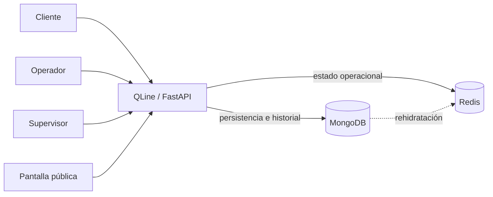
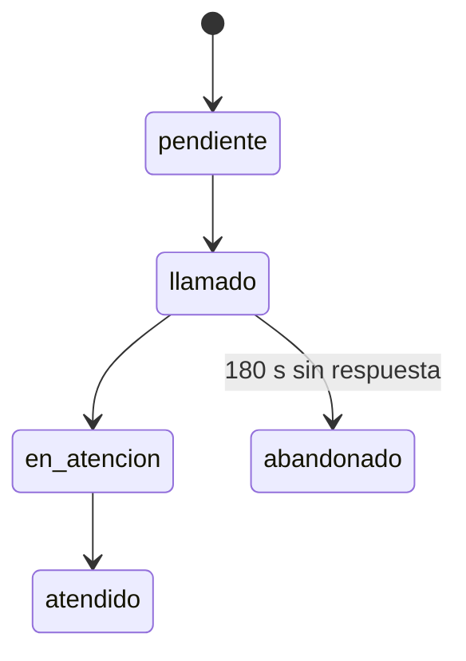
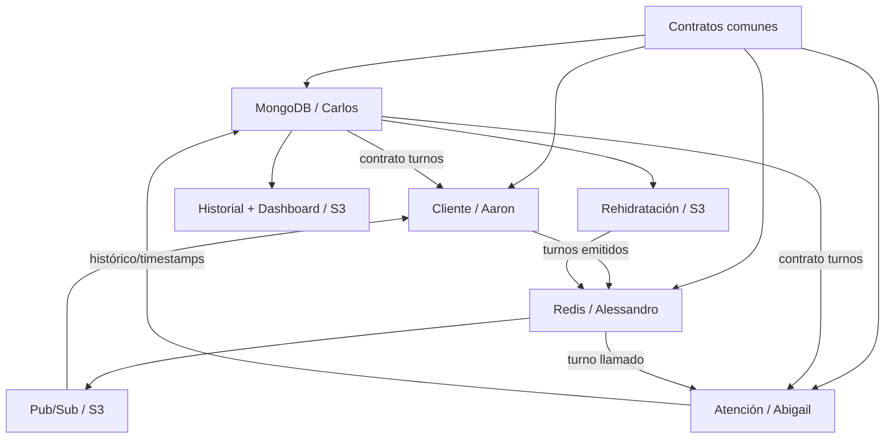

# QLine · Plan Maestro de Desarrollo, Backlog y Seguimientos

> **Documento de referencia para desarrollo, integración, GitHub Issues y trabajo asistido por IA**
>
> Proyecto final de **Tópicos Avanzados de Bases de Datos** · Universidad Nacional · **Grupo 2 / Query Logic**


---

## 0. Propósito y uso obligatorio de este documento

Este documento consolida el alcance funcional y técnico de **QLine** a partir de:

- el enunciado oficial del Proyecto Final Open Source;
- las decisiones aprobadas y documentadas en `docs/seguimientos/S1.md`;
- la estructura actual del repositorio;
- las decisiones de equipo tomadas para preparar el Seguimiento 2 y continuar el desarrollo hasta la entrega final.

Su objetivo es servir como **fuente de verdad operativa del equipo** para:

1. identificar qué debe construir QLine;
2. distinguir Historias de Usuario de tareas técnicas;
3. saber qué corresponde a cada desarrollador;
4. identificar qué debe estar listo para cada seguimiento;
5. reducir bloqueos entre ramas;
6. evitar que diferentes desarrolladores o asistentes de IA implementen contratos incompatibles;
7. preparar Issues, Pull Requests, demostraciones y bitácoras;
8. mantener el proyecto dentro del alcance aprobado.

### Regla de precedencia

Si existe una contradicción entre fuentes, se utiliza este orden:

1. **Enunciado oficial del Proyecto Final.**
2. **Este documento maestro.**
3. **Decisiones aprobadas en `S1.md` y seguimientos posteriores.**
4. **Issue específico de desarrollo.**
5. **Código existente.**

> Si una IA o un desarrollador detecta una contradicción que no puede resolverse con este orden, **no debe inventar la respuesta**. Debe detener el cambio y elevar la decisión al equipo.

---

# 1. Visión del producto

## 1.1 Nombre

**QLine**

## 1.2 Descripción

QLine es un sistema web de gestión de filas y turnos en tiempo real para entornos con múltiples ventanillas de atención.

Está pensado para contextos como:

- clínicas;
- municipalidades;
- cooperativas;
- universidades;
- bancos;
- centros de servicio.

## 1.3 Problema principal

Cuando varias ventanillas trabajan simultáneamente pueden aparecer problemas como:

- desorden en la atención;
- falta de visibilidad de la posición del cliente;
- dificultad para manejar atención preferencial;
- dos operadores intentando tomar el mismo turno;
- falta de trazabilidad de tiempos;
- imposibilidad de medir SLA;
- pérdida del estado operacional ante fallas temporales.

QLine debe resolver especialmente el problema de **concurrencia**:

```text
Cola:
A-015
A-016
A-017

Ventanilla V-01 solicita siguiente turno
Ventanilla V-02 solicita siguiente turno aproximadamente al mismo tiempo

Resultado permitido:
V-01 -> A-015
V-02 -> A-016

Resultado prohibido:
V-01 -> A-015
V-02 -> A-015
```

Objetivo de integridad:

```text
Turnos asignados duplicados = 0
```

## 1.4 Principio central

> **MongoDB conserva lo que ocurrió. Redis controla lo que ocurre ahora.**

---

# 2. Alcance confirmado del MVP

## 2.1 Incluido

QLine debe llegar a ofrecer:

- emisión web de turnos;
- interfaz de emisión tipo quiosco para clientes, sin navegación de administración, operación o supervisión dentro de esa vista;
- prioridad `normal` y `preferencial`;
- código único de turno;
- consulta de estado y posición;
- acceso al turno mediante QR con UUID v4 independiente del código visible, validación del enlace y consulta actualizada automáticamente en el MVP final;
- cola activa en Redis;
- atención desde múltiples ventanillas;
- selección atómica del siguiente turno;
- inicio y finalización de atención;
- abandono de un turno llamado después de 180 segundos sin respuesta;
- pantalla pública de turnos llamados;
- historial persistente en MongoDB;
- descarga JSON del historial completo según filtros aplicados;
- dashboard básico;
- descarga JSON de los indicadores del dashboard según el SLA seleccionado;
- métricas de espera, atención y SLA;
- recuperación de la cola después de una pérdida de Redis;
- CRUD administrativo de la entidad central `turnos` para cumplir el requisito académico;
- datos sintéticos y scripts reproducibles;
- pruebas y mediciones documentadas;
- documentación Open Source y release final.

## 2.2 Fuera del alcance

No forman parte del MVP:

- aplicación móvil nativa;
- WhatsApp;
- SMS;
- pagos;
- múltiples sucursales complejas;
- agenda avanzada de citas;
- Machine Learning;
- predicción automática de tiempos;
- modelos M/M/c;
- mapas;
- administración empresarial compleja de usuarios;
- autenticación avanzada adicional a la necesaria para el entorno del curso.

Cualquier ampliación debe aprobarse antes de convertirse en trabajo del equipo.

---

# 3. Stack y arquitectura ya aprobados

Estas decisiones **no deben replantearse unilateralmente** durante S2.

| Componente | Decisión actual |
|---|---|
| Lenguaje | Python 3.12 |
| Backend | FastAPI |
| MongoDB | Servidor del curso |
| Cliente MongoDB | PyMongo |
| Redis | Servidor compartido del curso |
| Cliente Redis | `redis-py` |
| Templates | Jinja2 |
| Servidor de aplicación | Uvicorn / Gunicorn según entorno |
| Publicación | Apache / proxy inverso existente |
| Configuración | Variables de entorno |
| Licencia | MIT |

## 3.1 Arquitectura conceptual



## 3.2 Responsabilidad de MongoDB

MongoDB es la fuente persistente de QLine.

Debe conservar como mínimo:

- turnos;
- identificador `qr_token` (UUID v4) de los turnos emitidos desde la ampliación S3;
- estado persistente;
- servicio;
- prioridad;
- ventanilla asociada;
- marcas de tiempo;
- historial necesario;
- métricas derivables;
- información necesaria para SLA.

> **Aclaración respecto a S1:** la colección `turnos` no debe interpretarse como completamente inmutable. El registro permanece históricamente, pero campos controlados como `estado`, `ventanilla`, timestamps y métricas evolucionan durante el ciclo del turno. La operación normal de QLine no elimina historial.

## 3.3 Responsabilidad de Redis

Redis representa el estado operacional inmediato.

Debe soportar:

- contador de códigos;
- cola activa;
- prioridad;
- orden de llegada;
- obtención atómica del siguiente turno;
- turno actual por ventanilla;
- estado temporal de turno llamado;
- TTL de abandono;
- eventos en tiempo real cuando se implemente Pub/Sub.

Redis **no sustituye** la persistencia histórica de MongoDB.

---

# 4. Contratos compartidos obligatorios

Todos los desarrolladores deben utilizar los mismos contratos.

No se permite crear una segunda interpretación del turno, de estados, prioridades o claves Redis dentro de una rama individual.

---

## 4.1 Servicio inicial del MVP

Para reducir complejidad y demostrar correctamente la concurrencia, el MVP comienza con un único servicio:

| Campo | Valor |
|---|---|
| ID | `atencion_general` |
| Nombre visible | `Atención General` |
| Estado | Activo |

No se requiere CRUD de servicios para S2.

La arquitectura puede permitir nuevos servicios posteriormente, pero no es requisito funcional del MVP actual.

---

## 4.2 Ventanillas iniciales

Se utilizarán inicialmente:

```text
V-01
V-02
V-03
```

No se requiere CRUD de ventanillas para S2.

La aplicación debe tratar las ventanillas como identificadores válidos acordados por el equipo.

---

## 4.3 Prioridades

Las únicas prioridades oficiales del MVP son:

```text
normal
preferencial
```

### Prioridad preferencial

La categoría `preferencial` contempla atención prioritaria para casos como:

- persona adulta mayor;
- persona embarazada;
- persona con discapacidad.

QLine no necesita almacenar la condición personal específica para demostrar el MVP. El contrato funcional requiere únicamente la prioridad `preferencial`.

### Regla de orden

```text
1. Prioridad
2. Orden de llegada
```

Entre turnos de la misma prioridad se conserva FIFO.

---

## 4.4 Estados oficiales del turno

Estados válidos:

```text
pendiente
llamado
en_atencion
atendido
abandonado
```

Flujo principal:



### Transiciones prohibidas

No debe permitirse:

- `atendido -> pendiente`;
- `abandonado -> llamado`;
- `pendiente -> atendido` directamente;
- finalizar un turno que nunca inició atención;
- iniciar un turno que no esté `llamado`;
- asignar un turno `atendido`;
- asignar un turno `abandonado`;
- tener el mismo turno activo simultáneamente en dos ventanillas.

---

## 4.5 Contrato conceptual de `turnos`

La entidad central del proyecto es `turnos`.

Modelo objetivo:

```json
{
  "_id": "ObjectId",
  "codigo": "A-015",
  "qr_token": "UUID-v4 (string)",
  "servicio": "atencion_general",
  "prioridad": "preferencial",
  "estado": "pendiente",
  "ventanilla": null,
  "operador": null,
  "timestamps": {
    "creado": "Date",
    "llamado": null,
    "inicio_atencion": null,
    "finalizado": null,
    "abandonado": null
  },
  "metricas": {
    "espera_seg": null,
    "atencion_seg": null
  }
}
```

### Reglas mínimas

- `codigo` debe ser único.
- `servicio` debe ser `atencion_general` mientras exista un único servicio.
- `prioridad` debe pertenecer al enum aprobado.
- `estado` debe pertenecer al enum aprobado.
- `ventanilla` debe ser `null` mientras no se haya llamado el turno.
- `timestamps.creado` es obligatorio.
- `timestamps.llamado` se establece cuando pasa a `llamado`.
- `timestamps.inicio_atencion` se establece cuando pasa a `en_atencion`.
- `timestamps.finalizado` se establece cuando pasa a `atendido`.
- `timestamps.abandonado` se establece cuando pasa a `abandonado`.
- `metricas.espera_seg` debe poder calcularse a partir de `creado` y `llamado`.
- `metricas.atencion_seg` debe poder calcularse a partir de `inicio_atencion` y `finalizado`.

> El JSON Schema real de MongoDB debe reflejar estas reglas sin impedir que campos que todavía no aplican permanezcan `null`.

### Ampliación S3 del contrato: identificador de consulta QR

- `codigo` (`A-001`, etc.) permanece como identificador visible y operacional. El contador y la cola de Redis **no cambian**.
- Los turnos operacionales **nuevos** generan un `qr_token` UUID v4 en formato de cadena, separado de `codigo`, que se persiste en el mismo documento MongoDB.
- `qr_token` es **opcional** en el esquema para mantener compatibles los turnos anteriores y los datos sintéticos que no lo contengan. Un valor presente debe tener formato UUID v4 válido.
- Se requiere unicidad de los `qr_token` presentes mediante índice único parcial que incluya exclusivamente valores de tipo cadena; la estrategia concreta y su validación corresponden a Carlos (TT-001/TT-002).
- No se debe reconstruir ni eliminar la colección como parte de la actualización documental. La aplicación del validador/índice requiere plan técnico de migración y acuerdo del equipo: en S2 se documentó la limitación de permisos de `collMod` del usuario MongoDB del curso.
- El token se utiliza únicamente para resolver la consulta del turno mediante HU-013; no se almacena en Redis ni altera los estados, prioridades o métricas.
- El QR contiene una URL pública del sistema que respeta `BASE_PATH` y dirige a `/turno/qr/{uuid}`; debe utilizar el dominio accesible desde el celular, no `localhost`.

---

# 5. Contrato Redis

## 5.1 Namespace obligatorio

Todas las claves y canales de Redis pertenecientes a QLine deben comenzar con:

```text
grupo2:qline:
```

Está prohibido crear claves del proyecto fuera de este namespace.

También están prohibidos:

```text
FLUSHALL
FLUSHDB
```

---

## 5.2 Estructuras acordadas

| Clave / canal | Tipo | Propósito | Seguimiento principal |
|---|---|---|---|
| `grupo2:qline:contador:atencion_general` | String | Consecutivo atómico mediante `INCR` | S2 |
| `grupo2:qline:cola:atencion_general` | Sorted Set | Cola ordenada por prioridad + llegada | S2 |
| `grupo2:qline:ventanilla:{id}:actual` | String | Turno actualmente asignado a una ventanilla | S2/S3 |
| `grupo2:qline:turno:{codigo}` | Hash + TTL | Estado temporal del turno llamado | S3 |
| `grupo2:qline:eventos` | Pub/Sub | Cambios de estado para vistas en vivo | S3 |

## 5.3 Contrato de la cola

Para `grupo2:qline:cola:atencion_general`:

- el miembro debe identificar inequívocamente el turno;
- el orden debe garantizar prioridad antes que llegada;
- igual prioridad debe conservar FIFO;
- la extracción del siguiente turno debe ser atómica;
- consultar la cola no debe remover elementos;
- llamar el siguiente turno sí debe retirar el turno de disponibilidad.

La fórmula exacta del `score` puede definirse durante la implementación, pero no puede violar esas reglas.

---

# 6. CRUD administrativo de `turnos`

El enunciado del Seguimiento 2 exige CRUD de la entidad central desde la interfaz.

QLine debe conservar una **interfaz administrativa/técnica** que permita demostrar:

```text
Create
Read
Update
Delete
```

sobre `turnos`.

## 6.1 Separación obligatoria

```text
CRUD administrativo / demostrativo
!=
flujo operacional normal de QLine
```

### Flujo operacional

En operación normal:

- un turno se crea mediante emisión;
- cambia de estado mediante acciones de negocio;
- QLine conserva su historial;
- no se elimina como parte del ciclo normal.

### Delete administrativo

`Delete` existe únicamente para:

- cumplir el CRUD requerido;
- administración técnica;
- datos de prueba;
- demostración controlada.

No debe presentarse como comportamiento normal del operador.

---

# 7. Épicas del proyecto

| Épica | Nombre | Objetivo | Principal seguimiento |
|---|---|---|---|
| **EP-01** | Fundación de datos | MongoDB, Redis, contratos y configuración reproducible | S2 |
| **EP-02** | Experiencia del cliente | Emitir, consultar y acceder al turno | S2-S3 |
| **EP-03** | Cola y concurrencia | Cola priorizada y llamada atómica | S2-S3 |
| **EP-04** | Ciclo de atención | Llamar, iniciar, finalizar y abandonar | S2-S3 |
| **EP-05** | Tiempo real | Pantalla pública y actualizaciones en vivo | S3 |
| **EP-06** | Historial y SLA | Auditoría y dashboard | S3 |
| **EP-07** | Resiliencia y evidencia | Recuperación, fallos, pruebas y mediciones | S3 |
| **EP-08** | Open Source y release | Instalación, documentación y publicación | S2-S4/Final |

---

# 8. Historias de Usuario oficiales

> Las HU describen comportamiento del producto. Los scripts, schemas, conexiones, índices y documentación se gestionan como tareas técnicas, no como HU artificiales.

---

## HU-001 · Emitir turno

**Épica:** EP-02  
**Responsable principal:** Aaron Benavides · `abenavides`  
**Prioridad:** MUST

**Como** cliente  
**Quiero** generar un turno para Atención General  
**Para** ingresar a la fila correspondiente.

### Criterios de aceptación

- Permite seleccionar `normal` o `preferencial`.
- Genera un código único.
- El turno se persiste en MongoDB.
- El turno ingresa a la cola Redis.
- Estado inicial: `pendiente`.
- Se registra `timestamps.creado`.
- Se muestra una confirmación al cliente.
- Un fallo no debe dejar silenciosamente un turno duplicado o parcialmente confirmado.

### Ampliación S3: interfaz tipo quiosco (retroalimentación S2)

- Ofrece una vista sencilla de emisión para el cliente, apta para tablet o dispositivo similar.
- Dentro del modo quiosco solo aparecen los controles necesarios para seleccionar `normal` o `preferencial`, emitir y obtener la confirmación del turno.
- La vista de quiosco no muestra enlaces de operador, supervisor ni administración; esos módulos permanecen disponibles desde la navegación general del sistema.
- Reutiliza el backend ya implementado de HU-001 sin crear otro flujo de emisión, otra prioridad o un rol de autenticación complejo.
- Permite comprobar por separado el recorrido del cliente y el acceso a la navegación técnica/administrativa.

### Dependencias

- Contrato `turnos`.
- Redis disponible para integración real.
- TT-001 / TT-002 / TT-006 / TT-007.

### Evolución por seguimiento

| Seguimiento | Expectativa |
|---|---|
| **S2** | **REQUIRED.** Emisión funcional con MongoDB + Redis reales. |
| **S3** | Validar errores, consistencia, concurrencia indirecta y fallos de motor; integrar la presentación tipo quiosco del cliente sin alterar la operación existente. |
| **S4** | Instalación reproducible y documentación final. |
| **Final** | Parte del flujo de demo principal. |

---

## HU-002 · Consultar mi turno

**Épica:** EP-02  
**Responsable principal:** Aaron Benavides · `abenavides`  
**Prioridad:** MUST

**Como** cliente  
**Quiero** consultar mi turno  
**Para** conocer su estado y mi posición actual.

### Criterios de aceptación

Debe mostrar como mínimo:

- código;
- servicio;
- prioridad;
- estado;
- cantidad de turnos antes cuando el estado permita calcular posición.

Además:

- no debe mostrar como pendiente un turno atendido;
- debe reflejar `abandonado` cuando aplique;
- un código inexistente produce respuesta controlada;
- la consulta no altera la cola.

### Evolución

| Seguimiento | Expectativa |
|---|---|
| **S2** | **REQUIRED** en versión básica. Puede refrescarse manualmente. |
| **S3** | Integración con actualizaciones en tiempo real si corresponde. |
| **S4** | Refinamiento/documentación. |
| **Final** | Disponible en demo. |

---

## HU-003 · Acceder al turno mediante QR

**Épica:** EP-02  
**Responsable principal:** Aaron Benavides · `abenavides`  
**Prioridad:** SHOULD

**Como** cliente  
**Quiero** disponer de un QR asociado a mi turno  
**Para** acceder fácilmente a su consulta.

### Criterios

- El QR identifica un turno concreto.
- No expone credenciales ni información sensible.
- Un QR inválido produce respuesta controlada.
- El destino utiliza la misma fuente funcional que HU-002.
- Cada turno operacional nuevo tiene un `qr_token` UUID v4 persistido, único e independiente del código consecutivo visible.
- El ticket de confirmación presenta el código visible y un QR legible que enlaza al turno desde otro dispositivo.
- El enlace usa la URL pública de QLine, respeta `BASE_PATH` y no utiliza `localhost`.
- Los turnos históricos sin `qr_token` permanecen consultables por el código existente de HU-002.
- Los fallos de generación o persistencia del token se gestionan de forma controlada, sin confirmar un turno incompleto silenciosamente.
- Incluye pruebas automáticas para UUID, persistencia, URL y compatibilidad con turnos previos.

### Dependencias

- **Funcional:** HU-001 para emitir y asociar el identificador a un turno; contrato compartido `turnos` (TT-001/TT-002).
- **De integración:** HU-013 consume el enlace y token generados; ambas historias pueden desarrollarse en paralelo una vez acordado el contrato de `qr_token` y la ruta de consulta.
- **Coordinación de contrato:** Carlos mantiene el diseño y los índices de MongoDB. La modificación del esquema requiere el acuerdo establecido en la sección 26.

### Evolución

| Seguimiento | Expectativa |
|---|---|
| **S2** | **PARALLEL. No obligatorio para aprobar el núcleo S2.** |
| **S3** | Objetivo funcional si no se completó antes. |
| **S4/Final** | Debe estar integrado para el MVP final. |

---

## HU-004 · Visualizar cola activa

**Épica:** EP-03  
**Responsable:** Alessandro Cambronero · `acambronero`  
**Prioridad:** MUST

**Como** operador  
**Quiero** visualizar los turnos disponibles  
**Para** conocer el estado actual de la cola.

### Criterios

- Solo muestra turnos disponibles.
- Respeta prioridad y llegada.
- Muestra código y prioridad.
- Consultar no remueve turnos.
- Un turno ya llamado no permanece como disponible.
- Un turno abandonado no aparece en la cola pendiente.

### Evolución

| Seguimiento | Expectativa |
|---|---|
| **S2** | **REQUIRED.** Cola Redis real visible desde aplicación. |
| **S3** | Pruebas de integración y rendimiento. |
| **Final** | Flujo estable. |

---

## HU-005 · Llamar al siguiente turno

**Épica:** EP-03  
**Responsable:** Alessandro Cambronero · `acambronero`  
**Prioridad:** MUST / CRITICAL

**Como** operador de ventanilla  
**Quiero** obtener el siguiente turno disponible  
**Para** continuar la atención respetando prioridad y orden de llegada.

### Criterios

- Una solicitud obtiene como máximo un turno.
- Respeta prioridad.
- Respeta FIFO dentro de la misma prioridad.
- La extracción es atómica.
- Estado pasa de `pendiente` a `llamado`.
- Se registra la ventanilla.
- Se registra `timestamps.llamado`.
- El turno deja de estar disponible para otro operador.
- Si no hay turnos se informa de forma controlada.

### Evolución

| Seguimiento | Expectativa |
|---|---|
| **S2** | **REQUIRED.** Primer uso real y demostrable de Redis como cola. |
| **S3** | Prueba formal de concurrencia y medición. |
| **S4/Final** | Estable, documentado y reproducible. |

---

## HU-006 · Iniciar atención

**Épica:** EP-04  
**Responsable:** Abigail Urbina · `aurbina`  
**Prioridad:** MUST

**Como** operador  
**Quiero** iniciar la atención de un turno llamado  
**Para** registrar cuándo comienza el servicio.

### Criterios

- Solo acepta turnos `llamado`.
- Cambia a `en_atencion`.
- Registra `timestamps.inicio_atencion`.
- Conserva la ventanilla asignada.
- No puede iniciar el mismo turno simultáneamente en dos ventanillas.
- Un error genera respuesta controlada.

### Evolución

| Seguimiento | Expectativa |
|---|---|
| **S2** | **REQUIRED.** Parte del flujo punta a punta. |
| **S3** | Pruebas de estados inválidos y fallos. |
| **Final** | Demo estable. |

---

## HU-007 · Finalizar atención

**Épica:** EP-04  
**Responsable:** Abigail Urbina · `aurbina`  
**Prioridad:** MUST

**Como** operador  
**Quiero** finalizar la atención  
**Para** cerrar correctamente el turno y conservar su historial.

### Criterios

- Solo acepta turno `en_atencion`.
- Cambia a `atendido`.
- Registra `timestamps.finalizado`.
- Permite calcular `metricas.atencion_seg`.
- El turno no queda en cola activa.
- El historial permanece en MongoDB.

### Evolución

| Seguimiento | Expectativa |
|---|---|
| **S2** | **REQUIRED.** Completa el núcleo punta a punta. |
| **S3** | Integración con historial, SLA y pruebas. |
| **Final** | Parte de demo principal. |

---

## HU-008 · Gestionar abandono de turno llamado

**Épica:** EP-04  
**Responsable:** Abigail Urbina · `aurbina`  
**Prioridad:** SHOULD

**Como** organización  
**Quiero** marcar como abandonado un turno llamado que no se presenta  
**Para** no bloquear indefinidamente la operación.

### Criterios

- TTL oficial: **180 segundos**.
- Aplica al turno llamado según el contrato técnico.
- Estado final del caso: `abandonado`.
- Registra timestamp de abandono.
- No puede ser atendido posteriormente sin una nueva decisión explícita de negocio.
- Permanece históricamente en MongoDB.

### Evolución

| Seguimiento | Expectativa |
|---|---|
| **S2** | Puede avanzarse; no es requisito principal de la demo. |
| **S3** | **TARGET.** TTL, Hash Redis y comportamiento probado. |
| **Final** | Integrado y documentado. |

---

## HU-009 · Pantalla pública de llamados

**Épica:** EP-05  
**Responsable:** Aaron Benavides · `abenavides`  
**Prioridad:** SHOULD

**Como** cliente en sala  
**Quiero** visualizar el turno llamado y la ventanilla  
**Para** saber cuándo debo presentarme.

### Criterios

- Muestra código de turno.
- Muestra ventanilla.
- No muestra datos personales.
- Refleja llamados recientes o actuales.
- No conserva indefinidamente un turno ya atendido como llamado activo.

### Evolución

| Seguimiento | Expectativa |
|---|---|
| **S2** | PARALLEL si existe capacidad. |
| **S3** | **TARGET.** Integración Pub/Sub + WebSocket/tiempo real según arquitectura. |
| **Final** | Disponible en demo. |

---

## HU-010 · Consultar historial de turnos

**Épica:** EP-06  
**Responsable:** Carlos Espinoza · `cespinoza`  
**Prioridad:** MUST para MVP final

**Como** supervisor  
**Quiero** consultar turnos procesados  
**Para** auditar lo ocurrido.

### Criterios

Debe permitir consultar al menos:

- código;
- prioridad;
- estado;
- ventanilla;
- creación;
- llamado;
- inicio de atención;
- finalización o abandono.

Debe poder derivarse:

- tiempo de espera;
- tiempo de atención.

Los datos permanecen aunque el turno ya no esté en Redis.

### Ampliación S3: descargar historial en JSON

- El supervisor puede descargar un archivo `.json` desde el historial, sin sustituir la vista ni la API existentes.
- El archivo incluye **todos los registros que coincidan con los filtros aplicados**, no solamente la página o los primeros resultados visibles.
- Conserva los campos de auditoría y las métricas derivadas ya contempladas en HU-010; evita credenciales o información sensible no requerida.
- La descarga reutiliza el filtrado y la lógica de consulta existentes; no cambia los estados ni datos persistidos.
- Se prueban exportaciones con y sin registros y el manejo controlado de errores de consulta.
- No se requiere exportación CSV.

### Evolución

| Seguimiento | Expectativa |
|---|---|
| **S2** | Puede adelantarse con datos sintéticos. |
| **S3** | **REQUIRED/TARGET.** Historial real integrado. |
| **Final** | Parte de la demostración de persistencia. |

---

## HU-011 · Dashboard básico y SLA

**Épica:** EP-06  
**Responsable:** Carlos Espinoza · `cespinoza`  
**Prioridad:** MUST para MVP final

**Como** supervisor  
**Quiero** visualizar indicadores operacionales  
**Para** conocer el desempeño del servicio.

### Indicadores mínimos

- turnos esperando;
- turnos atendidos;
- tiempo promedio de espera;
- tiempo promedio de atención;
- ventanillas activas o con turno actual;
- cumplimiento/incumplimiento de un objetivo SLA definido.

### Ampliación S3: descargar indicadores en JSON

- El supervisor puede descargar un archivo `.json` con los indicadores del dashboard.
- El archivo conserva el **objetivo SLA seleccionado** y los valores calculados por los aggregation pipelines existentes.
- La descarga reutiliza HU-011 sin recalcular indicadores con una lógica paralela ni alterar datos persistidos.
- Se prueban la descarga, el SLA seleccionado, la ausencia de datos y los errores controlados.
- No se requiere exportación CSV.

### Evolución

| Seguimiento | Expectativa |
|---|---|
| **S2** | No es requisito de demo; puede avanzarse con datos sintéticos. |
| **S3** | **TARGET.** Integración con datos reales y aggregation pipeline. |
| **Final** | Estable y documentado. |

---

## HU-012 · Recuperar la cola después de una pérdida de Redis

**Épica:** EP-07  
**Responsable:** Abigail Urbina · `aurbina`  
**Prioridad:** MUST para evidencia final

**Como** organización  
**Quiero** reconstruir la cola desde MongoDB después de una pérdida de Redis  
**Para** continuar sin perder turnos pendientes válidos.

### Criterios

- MongoDB conserva los turnos necesarios.
- Se identifican los turnos que deben regresar a cola.
- Se respeta prioridad.
- Se respeta llegada.
- No se generan duplicados.
- No se rehidratan turnos atendidos o abandonados.
- El resultado puede compararse antes/después.

### Evolución

| Seguimiento | Expectativa |
|---|---|
| **S2** | Diseñar compatibilidad; no es requisito principal de demo. |
| **S3** | **REQUIRED/TARGET.** Manejo de falla + evidencia de recuperación. |
| **Final** | Documentado y reproducible. |

---

## HU-013 · Validar QR y consultar el turno con actualización automática

**Épica:** EP-02  
**Responsable principal:** Alessandro Cambronero · `acambronero`  
**Prioridad:** SHOULD · Ampliación acordada tras la retroalimentación de S2

**Como** cliente  
**Quiero** escanear el QR y consultar automáticamente el estado actualizado de mi turno  
**Para** conocer mi posición o la ventanilla asignada sin introducir manualmente el código.

### Criterios de aceptación

- El QR abre una página web de QLine adaptada al navegador móvil, sin requerir una aplicación nativa.
- La ruta pública acordada es `/turno/qr/{uuid}`, integrada con `BASE_PATH` y el dominio del despliegue.
- La ruta valida el formato de UUID v4 y verifica que exista un documento `turnos` asociado a ese `qr_token`.
- La página muestra código, servicio, prioridad, estado y ventanilla cuando corresponda; para turnos `pendiente` muestra posición y cantidad de turnos por delante, si están disponibles.
- Obtiene el estado persistente desde MongoDB y reutiliza la lógica de HU-002 para consultar la posición en Redis, sin crear una segunda semántica de consulta.
- La información se **actualiza automáticamente sin recarga manual** cuando cambia el turno; la integración en tiempo real se coordina con TT-013 (Pub/Sub + WebSocket, según la arquitectura aprobada).
- Un UUID de formato inválido o inexistente genera una respuesta controlada; una falla MongoDB y una falla Redis se distinguen, y una falla Redis no oculta el estado disponible desde MongoDB.
- La consulta es de solo lectura: no modifica el turno, su orden en la cola ni las claves Redis.
- No se muestran datos personales ni credenciales, y el enlace no modifica permisos o roles.
- Existen pruebas automatizadas de consulta válida, UUID incorrecto, turno inexistente, actualización de estado, error Redis y navegación móvil.

### Dependencias

- **Funcional:** HU-003 genera el `qr_token` que permite resolver el enlace; HU-002 define el contrato de estado y posición; `turnos` (TT-001/TT-002) contiene el vínculo UUID → turno.
- **De integración:** TT-013 provee el mecanismo de notificación en vivo. Alessandro puede construir y probar la vista con UUID/documentos simulados mientras se completa HU-003 y la integración Pub/Sub.
- El acoplamiento entre HU-003 y HU-013 queda limitado al campo `qr_token`, el formato UUID v4 y la ruta `/turno/qr/{uuid}`; no modifica el contrato operacional Redis.

### Evidencia esperada

- Escaneo desde otro dispositivo, página de turno visible y actualización automática demostrable.
- Casos UUID inválido/inexistente y falla Redis documentados, más pruebas automáticas y PR independiente.

### Evolución

| Seguimiento | Expectativa |
|---|---|
| **S2** | No formaba parte del núcleo requerido; se identifica a partir del feedback posterior al seguimiento. |
| **S3** | TARGET: validación del QR, consulta móvil y actualización automática integrada con TT-013. |
| **S4/Final** | Integrado, probado y demostrable junto con HU-003. |

---

# 9. Tareas técnicas oficiales

---

## S2 · Fundación y núcleo funcional

| ID | Tarea técnica | Responsable | Estado requerido S2 |
|---|---|---|---|
| **TT-001** | Definir/implementar modelo final de colección `turnos` | Carlos | REQUIRED |
| **TT-002** | Crear JSON Schema de MongoDB para `turnos` | Carlos | REQUIRED |
| **TT-003** | Adaptar CRUD administrativo a la entidad `turnos` | Carlos | REQUIRED |
| **TT-004** | Crear script reproducible de inicialización MongoDB | Carlos | REQUIRED |
| **TT-005** | Crear script/datos sintéticos reproducibles | Abigail | REQUIRED |
| **TT-006** | Conectar aplicación al Redis del servidor | Alessandro | REQUIRED |
| **TT-007** | Implementar contrato `grupo2:qline:` y cola Sorted Set | Alessandro | REQUIRED |
| **TT-008** | Crear/corregir `.env.example` completo sin secretos | Aaron | REQUIRED |
| **TT-009** | Centralizar constantes comunes: servicio, ventanillas, prioridades, TTL | Equipo / contrato común | REQUIRED antes de integración |
| **TT-010** | Sanear baseline de repositorio y README; eliminar artefacto `=======` | Equipo | REQUIRED antes de tag v0.2.0 |

### TT-001 · Modelo `turnos`

Debe dejar definida la estructura descrita en la sección 4.5.

### TT-002 · JSON Schema

Debe impedir al menos:

- prioridad desconocida;
- estado desconocido;
- estructura inválida de timestamps;
- tipos incompatibles;
- documentos que no representen un turno válido mínimo.

Debe permitir campos `null` cuando el flujo todavía no haya alcanzado esa etapa.

### TT-003 · CRUD administrativo

Debe demostrar desde interfaz:

- Create;
- Read;
- Update;
- Delete.

Debe estar claramente separado del flujo normal del cliente/operador.

### TT-004 · Inicialización MongoDB

Debe existir un procedimiento reproducible que pueda:

- preparar la colección;
- aplicar validator/JSON Schema;
- dejar el entorno listo sin crear manualmente cada elemento.

### TT-005 · Datos sintéticos

Debe permitir disponer de información de prueba reproducible.

No utilizar datos personales reales.

### TT-006 / TT-007 · Redis

Debe existir conexión real y al menos:

- contador con `INCR`;
- cola Sorted Set;
- operación de lectura de cola;
- operación atómica para siguiente turno;
- namespace correcto.

### TT-008 · `.env.example`

Debe documentar como mínimo:

```text
MONGO_USER=
MONGO_PASS=
MONGO_DB=grupo2_db
MONGO_HOST=
MONGO_PORT=27017
REDIS_HOST=
REDIS_PORT=6379
REDIS_PASS=
BASE_PATH=/proyecto/qline
```

Nunca incluir valores secretos reales.

---

## S3 · Integración, pruebas y medición

| ID | Tarea | Responsable principal | Objetivo |
|---|---|---|---|
| **TT-011** | Completar al menos 3 estructuras Redis utilizadas realmente | Alessandro | Sorted Set + String + Hash (u otra válida) |
| **TT-012** | TTL/expiración y estrategia de estado temporal | Abigail + Alessandro | abandono 180 s |
| **TT-013** | Pub/Sub + actualización en vivo | Aaron + Alessandro | pantalla pública/cliente |
| **TT-014** | Índices MongoDB + `explain()` | Carlos | evidencia técnica |
| **TT-015** | Aggregation pipeline representativo | Carlos | historial/SLA |
| **TT-016** | Prueba formal de concurrencia | Alessandro | 0 duplicados |
| **TT-017** | Prueba de caída y rehidratación | Abigail | recuperación |
| **TT-018** | Mediciones: 3 operaciones, >=3 ejecuciones, mediana | Equipo, consolidación por responsables | rúbrica S3 |
| **TT-019** | Casos normal, conexión fallida y datos inválidos | Cada dueño de módulo | evidencia S3 |
| **TT-020** | `docs/decisiones.md` | Equipo | decisiones y alternativas |

### Ampliaciones funcionales derivadas del feedback S2

Estas ampliaciones **no sustituyen** las tareas técnicas oficiales de S3 ni se declaran completadas:

| HU | Trabajo adicional | Responsable | Integración principal |
|---|---|---|---|
| **HU-001** | Vista simplificada de emisión en modo quiosco | Aaron | Backend existente de emisión y navegación general separada |
| **HU-003** | UUID v4 persistente y QR del ticket | Aaron | Contrato `qr_token` revisado con Carlos |
| **HU-013 (nueva)** | Escaneo, validación y consulta móvil con actualización automática | Alessandro | HU-002 + HU-003 + TT-013 |
| **HU-010** | Descarga JSON de todos los registros filtrados del historial | Carlos | Consultas existentes de HU-010 |
| **HU-011** | Descarga JSON de indicadores con el SLA seleccionado | Carlos | Aggregation pipelines existentes de HU-011 |

La ampliación de `turnos` exige revisión de esquema e índices por Carlos (TT-001/TT-002), sin autorizar aquí ninguna migración, recreación de colección ni operación sobre el servidor.

### Nota sobre rendimiento

S1 registró como expectativa una latencia Redis muy baja y una mejora superior al 85 %. Para efectos del proyecto:

> esas cifras se consideran **hipótesis/objetivos iniciales**, no resultados garantizados.

En S3 deben medirse y reportarse los resultados reales.

---

## S4 / Final · Release y Open Source

| ID | Tarea | Responsable |
|---|---|---|
| **TT-021** | Probar instalación desde cero siguiendo solo README | Integrante distinto de quien preparó el entorno |
| **TT-022** | README final completo | Equipo |
| **TT-023** | `CHANGELOG.md` | Equipo |
| **TT-024** | Video demo 3-5 min | Equipo |
| **TT-025** | Presentación final | Equipo |
| **TT-026** | `portal.yml` | Equipo |
| **TT-027** | Mapa/documentación de claves Redis | Alessandro |
| **TT-028** | Script de carga MongoDB requerido para release / `mongosh` cuando aplique | Carlos |
| **TT-029** | Release/tag final | Equipo |

---

# 10. Matriz de seguimientos

## 10.1 Seguimiento 1 · Ya realizado

Resultado esperado del curso: problema, arquitectura y repositorio entendibles.

Estado base reportado:

- stack definido;
- FastAPI + MongoDB funcionando;
- CRUD genérico MongoDB existente;
- despliegue inicial;
- variables de entorno;
- Redis todavía pendiente de integración real.

---

## 10.2 Seguimiento 2 · Núcleo funcional

### Debe estar listo

#### Funcional

- [ ] HU-001 Emitir turno.
- [ ] HU-002 Consultar turno básico.
- [ ] HU-004 Visualizar cola.
- [ ] HU-005 Llamar siguiente.
- [ ] HU-006 Iniciar atención.
- [ ] HU-007 Finalizar atención.

#### MongoDB

- [ ] Colección/modelo `turnos` definido.
- [ ] JSON Schema aplicado.
- [ ] CRUD de `turnos` desde interfaz.
- [ ] Persistencia del flujo operacional.

#### Redis

- [ ] Conexión real desde QLine.
- [ ] Namespace `grupo2:qline:`.
- [ ] Contador de turnos.
- [ ] Cola Sorted Set.
- [ ] Llamada atómica de siguiente turno.

#### Reproducibilidad

- [ ] Script de inicialización.
- [ ] Script/datos sintéticos.
- [ ] `.env.example` completo.

#### GitHub / entrega

- [ ] Trabajo desde ramas personales.
- [ ] Integración mediante Pull Requests.
- [ ] Issues del hito S2 cerrados o reprogramados con justificación.
- [ ] `docs/seguimientos/S2.md` completado **al cierre del trabajo**, basado en hechos reales.
- [ ] Tag `v0.2.0`.

### No es obligatorio para la demo S2

Puede desarrollarse en paralelo, pero no debe desplazar el núcleo:

- QR terminado;
- pantalla pública en tiempo real;
- TTL/abandono completo;
- dashboard SLA;
- pruebas formales de 10 solicitudes concurrentes;
- benchmarks definitivos;
- rehidratación completa;
- índices/explain/aggregation formal.

---

## 10.3 Seguimiento 3 · Integración, pruebas y medición

Debe demostrar:

- [ ] MongoDB + Redis completamente integrados.
- [ ] caso normal documentado;
- [ ] error de conexión documentado;
- [ ] datos inválidos documentados;
- [ ] comportamiento cuando Redis no responde;
- [ ] mínimo 3 mediciones representativas;
- [ ] cada medición con 3 ejecuciones o más;
- [ ] reporte de mediana;
- [ ] Redis con al menos 3 estructuras relevantes;
- [ ] TTL/abandono;
- [ ] índices MongoDB + `explain()`;
- [ ] aggregation pipeline o evidencia equivalente requerida;
- [ ] concurrencia con 0 duplicados;
- [ ] recuperación/rehidratación;
- [ ] `docs/decisiones.md`;
- [ ] tag `v0.3.0`;
- [ ] bitácora `S3.md`.

### Ampliaciones acordadas después del seguimiento S2

Las siguientes metas de producto se añaden a la planificación de S3; no reemplazan los requisitos académicos anteriores ni constituyen evidencia de implementación:

- [ ] HU-001: comprobar modo quiosco de emisión sin mostrar opciones internas de otros roles.
- [ ] HU-003: generar UUID v4 y QR en nuevos turnos, manteniendo el código `A-NNN` y la compatibilidad histórica.
- [ ] HU-013: demostrar escaneo, validación y consulta móvil con actualización automática de estado/posición, integrada con TT-013.
- [ ] HU-010: descargar todos los registros del historial que cumplan los filtros en JSON.
- [ ] HU-011: descargar métricas del dashboard en JSON respetando el SLA seleccionado.
- [ ] Validar con el equipo la evolución del campo/índice `qr_token` antes de ejecutar cambios de esquema o migraciones.

---

## 10.4 Seguimiento 4 / Release candidate

Debe orientarse a:

- instalación reproducible;
- README final;
- variables de entorno explicadas;
- datos de prueba;
- capturas;
- CHANGELOG;
- video;
- presentación;
- `portal.yml`;
- mapa de claves Redis;
- script de carga MongoDB requerido;
- tag `v0.9.0` o `v1.0.0` según exposición.

---

# 11. Demo recomendada para Seguimiento 2

La demostración debe priorizar el flujo principal, no navegar por código durante cinco minutos.

## Flujo sugerido

```text
1. Emitir turno normal A-001
2. Emitir turno preferencial A-002
3. Mostrar ambos en MongoDB
4. Mostrar cola Redis / vista de cola
5. Demostrar que la prioridad coloca A-002 primero
6. V-01 llama siguiente -> A-002
7. Iniciar atención
8. Finalizar atención
9. Mostrar MongoDB con estado y timestamps finales
10. Mostrar brevemente CRUD de turnos + JSON Schema
```

### Mensaje técnico que debe quedar claro

```text
MongoDB conserva el registro.
Redis administra la cola activa.
La llamada del siguiente turno es atómica.
```

---

# 12. Distribución por desarrollador

> La carga se equilibra por complejidad, no por cantidad artificial de HU.

---

## 12.1 Aaron Benavides · `abenavides`

### Área principal

**Experiencia del cliente y visualización.**

### S2 obligatorio

#### Historias

- HU-001 · Emitir turno.
- HU-002 · Consultar mi turno.

#### Técnicas

- TT-008 · `.env.example` completo.
- Integración de vistas/formularios del flujo cliente.
- Validaciones de entradas correspondientes a sus HU.

### Desarrollo paralelo / posterior

- HU-001 · ampliación de interfaz cliente tipo quiosco.
- HU-003 · UUID v4 persistente y QR del ticket (contrato `qr_token`).
- HU-009 · Pantalla pública.
- Parte visual de actualizaciones en vivo durante S3 (TT-013).

### Dependencias de integración

- modelo `turnos` de Carlos;
- cola Redis de Alessandro;
- revisión con Carlos del campo UUID y su índice; contrato acordado con Alessandro para `/turno/qr/{uuid}` (HU-013).

### Regla contra bloqueo

Aaron **no debe esperar** a que los otros módulos estén terminados para construir su flujo.

Puede utilizar:

- documentos sintéticos compatibles con `turnos`;
- una función/mock de cola;
- códigos de prueba;
- respuestas controladas.

La integración real debe reemplazar los mocks antes de cerrar S2.

### No le corresponde como dueño

- JSON Schema MongoDB;
- diseño de la cola Redis;
- atomicidad de `ZPOPMIN`;
- ciclo iniciar/finalizar;
- recuperación de Redis;
- dashboard SLA.

---

## 12.2 Carlos Espinoza · `cespinoza`

### Área principal

**Persistencia, estructura de datos e información histórica.**

### S2 obligatorio

- TT-001 · Modelo `turnos`.
- TT-002 · JSON Schema.
- TT-003 · CRUD administrativo `turnos`.
- TT-004 · Inicialización reproducible de MongoDB.

### Desarrollo paralelo / posterior

- HU-010 · Historial y descarga JSON de todos los registros filtrados.
- HU-011 · Dashboard/SLA y descarga JSON según el umbral seleccionado.
- Revisión TT-001/TT-002: validación y unicidad parcial del `qr_token` opcional, sin ejecutarse una migración destructiva sin acuerdo.
- TT-014 · Índices + explain.
- TT-015 · Aggregation pipeline.
- TT-028 · Script de carga MongoDB final.

### Regla contra bloqueo

Carlos debe publicar/compartir el **contrato de datos** temprano, pero no necesita construir las HU de otros desarrolladores.

Los demás pueden trabajar con el contrato antes de que todo su bloque esté terminado.

### No le corresponde como dueño

- implementación de cola Redis;
- llamada atómica;
- interfaz cliente;
- panel operativo iniciar/finalizar;
- recuperación Redis.

---

## 12.3 Alessandro Cambronero · `acambronero`

### Área principal

**Redis, cola, prioridad y concurrencia.**

### S2 obligatorio

- HU-004 · Visualizar cola activa.
- HU-005 · Llamar siguiente.
- TT-006 · Conexión Redis.
- TT-007 · Namespace + Sorted Set + contador.

### Desarrollo paralelo / posterior

- TT-011 · Tres estructuras Redis.
- soporte Redis para TT-012 TTL.
- soporte Pub/Sub para TT-013.
- HU-013 · consulta por UUID y QR en navegador móvil con actualización automática, reutilizando HU-002 y TT-013.
- TT-016 · Prueba formal de concurrencia.
- TT-027 · Mapa de claves.

### Criterio técnico crítico

```text
Duplicados = 0
```

### Dependencias

Puede precargar Redis usando turnos sintéticos y no necesita esperar la interfaz cliente.

### No le corresponde como dueño

- UI de **emisión** y **generación** de QR del cliente (HU-001/HU-003); se exceptúa la vista de **consulta QR** HU-013, que sí le corresponde;
- JSON Schema MongoDB;
- historial/dashboard;
- implementación principal del ciclo iniciar/finalizar.

---

## 12.4 Abigail Urbina · `aurbina`

### Área principal

**Ciclo de atención y continuidad operacional.**

### S2 obligatorio

- HU-006 · Iniciar atención.
- HU-007 · Finalizar atención.
- TT-005 · Datos sintéticos reproducibles.
- Panel funcional de atención correspondiente a sus HU.

### Desarrollo paralelo / posterior

- HU-008 · Abandono 180 s.
- HU-012 · Recuperación Redis.
- TT-012 · TTL/estado temporal junto con Alessandro.
- TT-017 · prueba de recuperación.

### Regla contra bloqueo

Puede desarrollar utilizando un turno controlado:

```json
{
  "codigo": "A-015",
  "estado": "llamado",
  "ventanilla": "V-01"
}
```

No necesita esperar a que HU-005 esté integrada para programar HU-006/HU-007.

### No le corresponde como dueño

- diseño del JSON Schema;
- cola Sorted Set;
- emisión/consulta cliente;
- dashboard SLA.

---

# 13. Mapa de dependencias



## 13.1 Dependencia funcional

Implica que el flujo conceptual requiere otra etapa.

Ejemplo:

```text
HU-007 Finalizar atención
requiere conceptualmente
HU-006 Iniciar atención
```

## 13.2 Dependencia de integración

No debe bloquear el desarrollo.

Ejemplo:

```text
HU-002 Consultar turno
consume información de la cola,
pero puede desarrollarse con datos controlados.
```

### Regla obligatoria

> Una dependencia de integración **NO es una justificación para detener el desarrollo** cuando el contrato ya está definido.

## 13.3 Dependencias de las ampliaciones posteriores a S2

| Entregable | Dependencia funcional | Dependencia de integración / estrategia sin bloqueo |
|---|---|---|
| HU-001, modo quiosco (Aaron) | Emisión funcional HU-001 | Se desarrolla como presentación independiente, reutilizando el backend e impidiendo navegación interna solo en la vista quiosco. |
| HU-003, UUID/QR (Aaron) | HU-001 y contrato `turnos` | Carlos revisa campo e índice `qr_token`; HU-013 consume el enlace. Los tests pueden usar mocks del modelo y URL. |
| HU-013, consulta QR (Alessandro) | HU-003 como productor del token; HU-002 para estado y posición | TT-013 proporciona los eventos en vivo; Alessandro puede usar UUID/documentos simulados hasta la integración. |
| HU-010, descarga JSON (Carlos) | Historial HU-010 | Reutiliza filtros, campos y métricas; sin dependencia de HU-003 ni Redis adicional. |
| HU-011, descarga JSON (Carlos) | Dashboard HU-011 | Reutiliza aggregation pipelines y el SLA seleccionado; sin dependencia de HU-003 ni Redis adicional. |

**Contrato mínimo común HU-003 ↔ HU-013:** `qr_token` (UUID v4 en MongoDB), URL `/turno/qr/{uuid}` construida con dominio público + `BASE_PATH`, consulta de solo lectura mediante HU-002 y manejo diferenciado de token inválido, no encontrado, Redis/MongoDB no disponibles. La actualización automática se integra mediante TT-013.

La adaptación del esquema compartido se decide con el equipo conforme a la sección 26; esta documentación no representa autorización para recrear colecciones ni ejecutar migraciones. La dependencia funcional describe el orden lógico del flujo completo, **no** impide implementar cada HU por separado con contratos y mocks compatibles.

---

# 14. Contrato de integración entre ramas

## 14.1 Flujo

```text
branch personal
     ↓
Pull Request
     ↓
development
     ↓
validación integrada
     ↓
main / tag de seguimiento
```

## 14.2 Situación actual a corregir antes de S2

En el snapshot revisado del repositorio:

- `main` contiene cambios posteriores a `development`;
- varias ramas personales están detrás de `main`;
- existe un artefacto `=======` en `README.md` que debe limpiarse.

### Acción previa

1. actualizar `development` con la base estable aprobada;
2. cada desarrollador sincroniza su rama desde `development`;
3. confirmar que la aplicación base inicia;
4. comenzar Issues S2 desde esa línea común.

No iniciar cuatro implementaciones incompatibles desde ramas desactualizadas.

---

# 15. Definition of Ready

Una HU o tarea técnica está lista para comenzar cuando:

- tiene ID;
- tiene dueño;
- tiene seguimiento objetivo;
- tiene criterios de aceptación;
- los contratos que consume están definidos;
- sus dependencias están clasificadas;
- existe una estrategia de datos de prueba si depende de otro módulo.

---

# 16. Definition of Done

Una HU solamente está terminada cuando:

- cumple todos sus criterios;
- respeta el modelo `turnos`;
- respeta estados oficiales;
- respeta prioridades;
- utiliza el namespace Redis cuando corresponda;
- maneja entradas inválidas de forma controlada;
- no deja inconsistencias conocidas;
- tiene evidencia de prueba;
- no rompe funcionalidades ya integradas;
- está incluida en PR revisable;
- no contiene secretos;
- no agrega alcance no aprobado.

Una tarea técnica está terminada cuando:

- produce el artefacto esperado;
- es reproducible;
- está documentada lo suficiente para que otro integrante la utilice;
- ha sido validada contra el entorno o datos de prueba correspondientes.

---

# 17. Reglas de consistencia transversal

## MongoDB / Redis

No son válidos estados como:

```text
MongoDB: atendido
Redis: todavía pendiente en cola
```

ni:

```text
MongoDB: abandonado
Redis: disponible para llamada
```

ni:

```text
V-01: A-015
V-02: A-015
```

## Reintentos

Una operación reintentada no debe generar automáticamente:

- dos códigos;
- dos turnos;
- doble llamada;
- doble finalización.

Cuando una operación multi-motor no pueda completarse, debe existir manejo controlado y una estrategia explícita; no ocultar estados parciales.

---

# 18. Validaciones técnicas obligatorias del proyecto

## 18.1 Concurrencia

S3 debe ejecutar solicitudes concurrentes.

Meta funcional:

```text
10 solicitudes concurrentes simuladas
0 turnos duplicados
```

No es necesario disponer físicamente de 10 ventanillas configuradas en el MVP; la prueba puede simular consumidores concurrentes.

## 18.2 Rendimiento

Debe medirse, no asumirse.

Registrar por operación:

- número de ejecuciones;
- mínimo;
- máximo;
- mediana;
- interpretación.

El proyecto debe cumplir el mínimo de mediciones exigido por el seguimiento correspondiente.

## 18.3 Recuperación

Escenario mínimo:

```text
1. Crear turnos pendientes
2. Confirmar persistencia MongoDB
3. Simular pérdida/indisponibilidad Redis
4. Restaurar Redis
5. Rehidratar
6. Comparar antes/después
```

Objetivo:

```text
100% de turnos pendientes válidos recuperados
0 duplicados
```

## 18.4 Datos inválidos

Probar al menos:

- prioridad inválida;
- estado inválido;
- turno inexistente;
- transición inválida;
- documento MongoDB rechazado por validator.

---

# 19. Aspectos obligatorios del proyecto completo

Estos elementos no son HU, pero forman parte de la entrega académica.

## Repositorio

- [ ] público;
- [x] licencia MIT;
- [x] `.gitignore`;
- [ ] `.env.example` real y completo;
- [ ] estructura clara;
- [ ] commits de todos;
- [ ] PRs de integración.

## Datos

- [ ] datos sintéticos;
- [ ] script reproducible;
- [ ] sin datos personales reales.

## Arquitectura

- [ ] diagrama actualizado;
- [ ] responsabilidad MongoDB;
- [ ] responsabilidad Redis;
- [ ] modelo de datos;
- [ ] mapa de claves Redis al cierre.

## Seguimientos

- [x] `S1.md`;
- [ ] `S2.md`;
- [ ] `S3.md`;
- [ ] `S4.md`.

> Las bitácoras deben registrar trabajo realmente realizado. No deben completarse anticipadamente con resultados ficticios.

## Release

- [ ] README final;
- [ ] CHANGELOG;
- [ ] video 3-5 min;
- [ ] `portal.yml`;
- [ ] release/tag correspondiente;
- [ ] demo en vivo;
- [ ] instalación reproducible desde cero.

---

# 20. Uso de este documento con asistentes de IA

Cada integrante puede entregar este documento a una IA y pedir:

```text
"Identifica lo que me corresponde como <nombre/branch> para el Seguimiento 2"
```

La IA debe poder responder utilizando las secciones de responsabilidades y seguimientos.

## Prompt base recomendado

> Estás colaborando en el proyecto QLine. Este documento es la fuente de verdad del desarrollo después del enunciado oficial del curso.
>
> Primero identifica mi nombre, branch, Historias de Usuario y tareas técnicas asignadas.
>
> No desarrolles funcionalidades pertenecientes a otro responsable salvo una necesidad explícita de integración.
>
> No inventes reglas de negocio, estados, prioridades, claves Redis ni campos MongoDB que contradigan los contratos del documento.
>
> Si una dependencia es de integración, no me bloquees innecesariamente: utiliza mocks o datos sintéticos compatibles con el contrato hasta que el módulo real esté disponible.
>
> Antes de modificar código existente, revisa la estructura actual y explica qué archivos deberán cambiar.
>
> Trabaja incrementalmente. No realices cambios masivos o refactors fuera de alcance.
>
> Para cada HU valida todos sus criterios de aceptación antes de considerarla terminada.
>
> Si detectas una contradicción entre código, este documento y el enunciado oficial, indícala antes de continuar.

## Reglas adicionales para IA

La IA **no debe**:

- cambiar de FastAPI a otro framework por iniciativa propia;
- cambiar MongoDB o Redis por otros motores;
- cambiar el namespace `grupo2:qline:`;
- inventar nuevos estados;
- inventar nuevas prioridades;
- agregar autenticación compleja;
- crear CRUD adicionales no requeridos;
- asumir que S2 exige todo S3;
- declarar pruebas aprobadas sin ejecutarlas;
- declarar resultados de rendimiento sin medirlos.

---

# 21. Formato recomendado para GitHub Issues

## HU

```markdown
## HU-XXX · Título

**Épica:** EP-XX
**Responsable:** Nombre / branch
**Seguimiento:** S2 / S3 / Final

### Historia
Como ...
Quiero ...
Para ...

### Criterios de aceptación
- [ ] ...
- [ ] ...

### Dependencias
- ...

### Evidencia esperada
- ...
```

## Tarea técnica

```markdown
## TT-XXX · Título

**Responsable:** Nombre / branch
**Seguimiento:** S2 / S3 / Final

### Objetivo
...

### Criterios de finalización
- [ ] ...
- [ ] ...

### Contratos afectados
- MongoDB / Redis / configuración / documentación

### Evidencia
- archivo, prueba, captura, commit o demo
```

---

# 22. Checklist para Pull Request

Antes de abrir PR hacia `development`:

- [ ] branch sincronizado con `development`;
- [ ] Issue asociado;
- [ ] criterios de aceptación revisados;
- [ ] no existen secretos;
- [ ] no se utilizaron `FLUSHALL` / `FLUSHDB`;
- [ ] claves Redis usan `grupo2:qline:`;
- [ ] estados y prioridades son oficiales;
- [ ] datos de prueba no son reales;
- [ ] aplicación inicia;
- [ ] funcionalidad puede demostrarse;
- [ ] dependencias de integración están identificadas;
- [ ] no se modificaron módulos ajenos sin necesidad.

---

# 23. Checklist previo al Seguimiento 2

## Demo

- [ ] generación de turno;
- [ ] prioridad normal/preferencial;
- [ ] cola Redis;
- [ ] consulta de turno;
- [ ] llamada siguiente;
- [ ] inicio atención;
- [ ] finalización;
- [ ] persistencia MongoDB.

## Base de datos

- [ ] colección `turnos`;
- [ ] JSON Schema;
- [ ] CRUD desde interfaz;
- [ ] script inicialización;
- [ ] datos sintéticos.

## Configuración

- [ ] `.env.example`;
- [ ] sin credenciales;
- [ ] Redis del servidor;
- [ ] namespace correcto.

## GitHub

- [ ] PRs;
- [ ] Issues S2;
- [ ] cada integrante con aportes;
- [ ] README limpio;
- [ ] S2.md basado en resultados reales;
- [ ] tag `v0.2.0`.

---

# 24. Preguntas que todos deben poder responder en el seguimiento

Cada integrante debe entender:

1. ¿Qué dato vive en MongoDB y por qué?
2. ¿Qué dato vive en Redis y por qué?
3. ¿Por qué Redis ayuda a evitar doble asignación?
4. ¿Cuál es la entidad central?
5. ¿Cuáles son los estados válidos?
6. ¿Cómo funciona prioridad preferencial vs normal?
7. ¿Qué significa el namespace `grupo2:qline:`?
8. ¿Qué ocurre si Redis falla? — aunque la recuperación formal se pruebe en S3.
9. ¿Por qué existe CRUD administrativo si el historial normal no se elimina?
10. ¿Qué parte desarrolló personalmente cada integrante?

---

# 25. Decisiones cerradas

| Decisión | Estado |
|---|---|
| MongoDB en servidor del curso | Cerrada |
| Redis en servidor del curso | Cerrada |
| Namespace Redis `grupo2:qline:` | Cerrada |
| Servicio inicial `Atención General` | Cerrada |
| Ventanillas `V-01`, `V-02`, `V-03` | Cerrada |
| Prioridades `normal` / `preferencial` | Cerrada |
| Preferencial cubre adulto mayor, embarazo y discapacidad | Cerrada |
| TTL abandono 180 s | Cerrada |
| QR es MVP, no requisito obligatorio S2 | Cerrada |
| CRUD administrativo de `turnos` se conserva | Cerrada |
| Delete solo administrativo/datos de prueba | Cerrada |
| Operación normal conserva historial | Cerrada |
| No CRUD de ventanillas para S2 | Cerrada |
| FastAPI / PyMongo / redis-py / Jinja2 | Cerrada desde S1 |

### Ampliaciones de alcance acordadas en la planificación posterior a S2

Las siguientes decisiones recogen la retroalimentación de S2 y la distribución definida para la próxima iteración. **No significan trabajo implementado ni sustituyen la revisión colegiada del contrato MongoDB.**

| Decisión de planificación | Responsable / condición |
|---|---|
| Conservar `A-NNN` visible y añadir UUID v4 `qr_token` en turnos nuevos | Aaron, HU-003; esquema e índice revisados por Carlos |
| Mostrar QR en el ticket para abrir una URL pública de consulta | Aaron, HU-003 |
| Validar el UUID y mostrar estado/posición con actualización automática | Alessandro, HU-013; integra TT-013 |
| Interfaz sencilla tipo quiosco para emisión, sin navegación administrativa | Aaron, ampliación HU-001 |
| Descargar historial completo filtrado en JSON y dashboard JSON según SLA | Carlos, ampliación HU-010/HU-011 |
| No incorporar CSV, predicción de espera, push móvil ni cambios al flujo Redis por estos ajustes | Control de alcance |

---

# 26. Decisiones que requieren acuerdo si aparecen durante desarrollo

No deben resolverse unilateralmente:

- añadir nuevos estados;
- añadir nuevas prioridades;
- añadir nuevos servicios al MVP;
- cambiar el esquema compartido de `turnos`;
- cambiar el significado de una clave Redis;
- modificar el TTL oficial;
- introducir otra base de datos;
- introducir autenticación/roles complejos;
- cambiar el flujo de branches;
- ampliar el alcance del MVP.

**Aplicación de esta regla a S3:** antes de modificar el esquema/índices del motor MongoDB para `qr_token`, Carlos y el equipo deben revisar y acordar la compatibilidad con documentos existentes, la unicidad parcial y una migración no destructiva. La bitácora S2 registra que la cuenta del curso no puede utilizar `collMod` sobre una colección existente. La documentación por sí sola no habilita ejecutar `--recrear`, borrar datos ni desplegar cambios.

---

# 27. Resumen ejecutivo de responsabilidades

| Integrante | Branch | S2 principal | Después de S2 |
|---|---|---|---|
| **Aaron Benavides** | `abenavides` | Emitir, consultar, `.env.example` | Quiosco HU-001, UUID/QR HU-003, pantalla pública HU-009 |
| **Carlos Espinoza** | `cespinoza` | Modelo Mongo, JSON Schema, CRUD, init DB | Historial y dashboard con descarga JSON, revisión índice/esquema `qr_token`, índices/aggregation |
| **Alessandro Cambronero** | `acambronero` | Redis, cola, llamar siguiente | HU-013 consulta QR automática, concurrencia, estructuras Redis, Pub/Sub TT-013 |
| **Abigail Urbina** | `aurbina` | Iniciar, finalizar, datos sintéticos | abandono/TTL, recuperación |

---

# 28. Criterio de éxito del MVP

QLine se considera funcional cuando puede demostrar de forma reproducible:

```text
Emitir turno
    ↓
Persistir en MongoDB
    ↓
Encolar en Redis
    ↓
Consultar posición/estado
    ↓
Llamar siguiente sin duplicar
    ↓
Iniciar atención
    ↓
Finalizar atención
    ↓
Conservar historial
    ↓
Mostrar métricas
```

Y además:

```text
concurrencia → 0 duplicados
fallo Redis → recuperación controlada
MongoDB → historial persistente
Redis → cola operacional
instalación → reproducible
```

---

# 29. Nota final

Este documento define **qué debe construirse, quién es responsable, qué contratos deben respetarse y qué se espera en cada seguimiento**.

No pretende sustituir:

- el enunciado oficial;
- los Issues;
- los Pull Requests;
- las bitácoras S1-S4;
- la documentación de decisiones técnicas.

Su función es evitar que esos elementos se contradigan entre sí.

> **Regla de oro de QLine:** desarrollar el proyecto completo de forma continua, pero demostrar en cada seguimiento exactamente el nivel de madurez que corresponde, sin inventar resultados ni retrasar trabajo que ya puede realizarse en paralelo.
