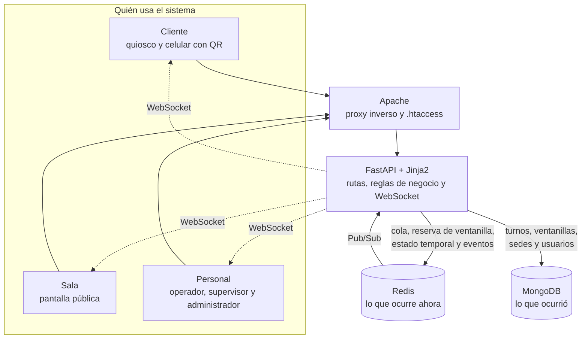
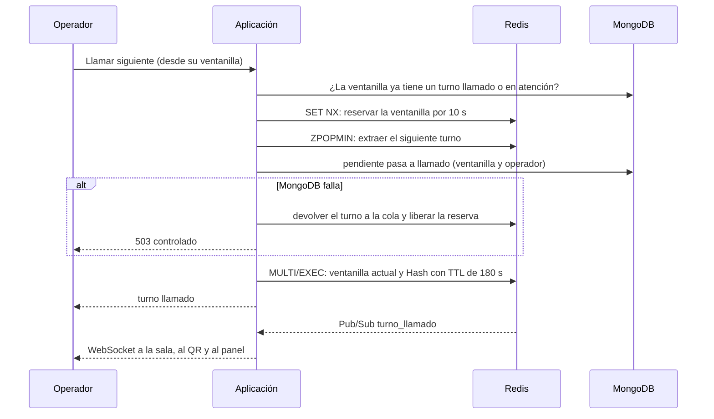

# Arquitectura de QLine

Este documento responde las cuatro preguntas que debe contestar la arquitectura de un proyecto con dos motores de datos:

1. [¿Qué dato vive en cada motor y por qué?](#qué-dato-vive-en-cada-motor-y-por-qué)
2. [¿Qué ocurre si Redis (o MongoDB) se cae?](#qué-pasa-si-algo-falla)
3. [¿Cómo se mantienen consistentes los datos entre motores?](#consistencia-entre-motores)
4. [¿Qué se midió para demostrar una mejora real?](#qué-se-midió)

El mapa detallado de claves de Redis está en [`redis_claves.md`](redis_claves.md); el canal de eventos, en [`tiempo_real.md`](tiempo_real.md); la consulta por QR, en [`qr_consulta.md`](qr_consulta.md). Las decisiones y sus alternativas están en [`../decisiones.md`](../decisiones.md).

## Vista general

QLine es un perfil de **dos motores** (MongoDB y Redis) detrás de una aplicación FastAPI. Una frase resume el reparto: *MongoDB conserva lo que ocurrió; Redis controla lo que ocurre ahora.*

| Capa | Responsabilidad |
|---|---|
| **Apache** | Publica la aplicación bajo una subruta, hace de proxy (también para WebSocket) y protege con contraseña todo salvo el QR y `/static/` (decisión D-22) |
| **FastAPI + Jinja2** | Pantallas, API JSON, reglas de negocio, inicio de sesión por rol y el hilo que reparte los eventos de Redis por WebSocket |
| **Barrido de abandono** | Hilo de la aplicación que marca como abandonados los turnos llamados que no se presentaron en 180 s (D-17 y D-18) |
| **Redis** | Estado en vivo: orden de atención, quién ocupa cada ventanilla, tiempo para presentarse y avisos |
| **MongoDB** | Memoria permanente: cada turno con su historia, métricas, cuentas de usuario y catálogos |

## Qué dato vive en cada motor y por qué

| Dato | Motor | Estructura | Por qué ahí |
|---|---|---|---|
| Orden de atención (prioridad y llegada) | Redis | Sorted Set `cola`; el puntaje combina prioridad y hora de llegada | `ZPOPMIN` entrega el siguiente turno de forma **atómica**: dos ventanillas simultáneas nunca reciben el mismo |
| Ventanilla ocupada | Redis | String `ventanilla:{id}:actual` con `SET NX` | La reserva atómica impide dos turnos en una ventanilla |
| Tiempo para presentarse | Redis | Hash `turno:{codigo}` con **TTL de 180 s** | El vencimiento lo cuenta el propio motor, sin tareas que lo vigilen |
| Contador de códigos | Redis | String con `INCR` | Códigos únicos y consecutivos sin carreras |
| Avisos de cambios | Redis | Canal Pub/Sub `eventos` | Empuja los cambios a la sala, al QR y a la vista del operador sin consultar |
| **El turno y toda su historia** | MongoDB | Colección `turnos` con `$jsonSchema` | Es la **fuente de verdad** del estado: marcas de tiempo, métricas, cierre con motivo y nota, operador |
| Historial, KPI y SLA | MongoDB | Índices y *aggregation pipelines* sobre `turnos` | Consultas analíticas que Redis no resuelve |
| Cuentas y roles del personal | MongoDB | Colección `usuarios` (hash de contraseña, rol, estado, ventanilla asignada) | Datos permanentes; Redis solo guarda lo efímero |
| Catálogo de ventanillas y de sedes | MongoDB | Colecciones `ventanillas` y `sucursales` | Datos de configuración que cambian poco |

Todas las claves de Redis llevan el prefijo `grupo2:qline:`; está prohibido `FLUSHALL` y `FLUSHDB`.

### Modelo de datos en MongoDB

| Colección | Contenido | Índices destacados |
|---|---|---|
| `turnos` | Código (`A-NNN`), servicio, prioridad, estado (`pendiente`, `llamado`, `en_atencion`, `atendido`, `abandonado`), ventanilla, operador, `qr_token`, marcas de tiempo, métricas (`espera_seg`, `atencion_seg`) y `cierre` opcional | Código único, estado + creación, ventanilla, creación descendente, estado + llamado (barrido) y `qr_token` único |
| `ventanillas` | Código `V-NN`, nombre, tipo, estado (activa o inactiva) | Sucursal + código único |
| `sucursales` | Catálogo de sedes (extra del trabajo, RFC-004) | Código único; estado + nombre |
| `usuarios` | Usuario (solo letras), hash `scrypt`, rol, estado, ventanilla asignada, sesión | Usuario único; **ventanilla asignada única** (índice parcial) |

Los turnos no guardan datos personales del cliente: solo código, prioridad y tiempos.

## Flujos principales

### Emitir un turno

El cliente elige «normal» o «preferencial» en el quiosco. La aplicación genera el código con `INCR`, guarda el turno en MongoDB con su `qr_token` (UUID v4) y lo pone en la cola de Redis. El ticket muestra el código y un QR que abre `/turno/qr/{uuid}`. Se publica un evento `turno_emitido`.

### Llamar al siguiente turno

### Atender, finalizar y abandonar

- **Iniciar atención:** `llamado` pasa a `en_atencion` y se elimina el Hash temporal (el cliente se presentó).
- **Finalizar:** `en_atencion` pasa a `atendido` en un solo `update_one` que exige el estado, la ventanilla y el inicio leído, de modo que dos finalizaciones simultáneas no se pisan. Opcionalmente guarda un motivo de una lista cerrada y una nota de hasta 200 caracteres. Libera la ventanilla en Redis.
- **Abandono:** si el Hash vence (180 s) sin que el cliente se presente, el barrido marca el turno como `abandonado`, libera la ventanilla y publica el evento.

### Consulta del cliente

La página del QR consulta su propio estado y se mantiene al día por WebSocket; si el socket no estuviera disponible, sigue consultando cada pocos segundos. Solo da acceso de lectura a un turno y exige un UUID v4, imposible de adivinar.

### Inicio de sesión y permisos del personal

El cliente y la sala no necesitan sesión. El personal ingresa con usuario y contraseña (solo se guarda un hash `scrypt`); la sesión viaja en una cookie firmada y **se vuelve a leer el usuario en MongoDB en cada petición**, de modo que deshabilitar a alguien o cambiarle el rol surte efecto al instante.

| Rol | Puede |
|---|---|
| Operador | Trabajar en **su** ventanilla (la asigna el supervisor): llamar, iniciar y finalizar |
| Supervisor | Además, ver el panel de todas las ventanillas, el historial y el dashboard, y asignar ventanillas |
| Administrador | Además, administrar usuarios, ventanillas, sedes y los datos |

Una prueba recorre todas las rutas de la aplicación contra esta política y falla si aparece una sin clasificar (`tests/test_acceso_roles.py`). La decisión completa es la D-35.

## Consistencia entre motores

Dos reglas mantienen alineados los motores:

1. **MongoDB decide el estado; Redis decide el orden y la reserva.** Si discrepan, gana MongoDB: un turno `llamado` o `en_atencion` ocupa la ventanilla aunque Redis haya perdido la clave, y una clave que apunta a un turno ya terminado se repara.
2. **El orden de escritura está pensado para poder deshacerse.** Primero se reserva y se extrae de Redis; solo cuando MongoDB confirma el cambio de estado se escribe el estado definitivo en Redis. Si MongoDB falla, el turno vuelve a la cola en su posición original; si el proceso muere a mitad, la reserva expira sola a los 10 s.

Para lo que se desalinea de todos modos hay dos mecanismos:

- **Rehidratación y reconciliación** (`python -m scripts.rehidratar_cola`): compara la cola de Redis con los turnos `pendiente` de MongoDB, repone los que faltan en la cola y retira los que ya no son pendientes. Muestra el plan y solo escribe con `--aplicar`. Es idempotente (decisión D-20).
- **Barrido de abandono:** marca como `abandonado` los turnos llamados cuyo plazo venció y libera su ventanilla, aunque Redis haya perdido el Hash.

## Qué pasa si algo falla

| Falla | Qué hace QLine | Dónde está verificado |
|---|---|---|
| **Redis no responde** | La emisión, el llamado y la cola responden **503 controlado** sin dejar un turno a medias. La página de la cola muestra un aviso en lugar de romperse. El panel y la consulta por QR **siguen funcionando con lo que conserva MongoDB**. `/salud` responde 503 | [`../evidencia/fallos.md`](../evidencia/fallos.md) (28 casos, 0 respuestas 500) |
| **Redis pierde los datos** | `rehidratar_cola` reconstruye la cola desde MongoDB | `tests/` y el informe de recuperación |
| **MongoDB no responde** | Una llamada ya extraída **vuelve a la cola**; las consultas y las escrituras responden 503 con un mensaje claro, nunca 500. `/salud` responde 503 | Pruebas automáticas de los módulos de llamado, atención y QR |
| **Se cae el WebSocket** | Cada pantalla consulta su API JSON cada pocos segundos (la vista del operador, cada 5 s). Nadie tiene que recargar | [`tiempo_real.md`](tiempo_real.md) |
| **El proceso muere entre la reserva y la confirmación** | La reserva de la ventanilla expira a los 10 s y MongoDB sigue siendo quien decide si está ocupada | [`redis_claves.md`](redis_claves.md) |
| **El cliente no se presenta** | A los 180 s el turno pasa a `abandonado` y la ventanilla queda libre | Pruebas de abandono |
| **Un evento no se publica** | La operación **no se deshace**: los avisos son de mejor esfuerzo y las pantallas se reconcilian por consulta | [`tiempo_real.md`](tiempo_real.md) |

Las pruebas automáticas usan Redis y MongoDB simulados; los informes de `docs/evidencia/` se generan con los servicios reales del servidor (ver [`../evidencia/README.md`](../evidencia/README.md)).

## Qué se midió

Mediciones desde la aplicación contra el servidor del curso, con **5 ejecuciones** de 200 operaciones cada una y la **mediana** de las medianas (informes en `docs/evidencia/`):

| Operación | Redis | MongoDB | Resultado |
|---|---|---|---|
| Generar el código del turno | 0.108 ms (`INCR`) | 0.376 ms (`find_one_and_update` con `$inc`) | Redis 3.5 veces más rápido |
| Poner el turno en la cola | 0.126 ms (`ZADD`) | 0.347 ms (`insert_one`) | Redis 2.8 veces más rápido |
| Sacar el siguiente turno | 0.135 ms (`ZPOPMIN`) | 0.493 ms (`find_one_and_update`) | Redis 3.7 veces más rápido |

El costo no es el motivo principal de usar Redis: lo es la **atomicidad**. La prueba de concurrencia lanza 10 consumidores simultáneos y comprueba **259 asignaciones sin ningún turno duplicado**, con la prioridad respetada ([`../evidencia/concurrencia.md`](../evidencia/concurrencia.md)). Los índices de MongoDB se comparan con y sin índice mediante `explain()` en [`../evidencia/indices_mongo.md`](../evidencia/indices_mongo.md).

La interpretación completa, incluida la hipótesis inicial de S1 que **no** se cumplió (mejora de más del 85 % frente a MongoDB), está en el informe de rendimiento: [`../evidencia/rendimiento.md`](../evidencia/rendimiento.md).
