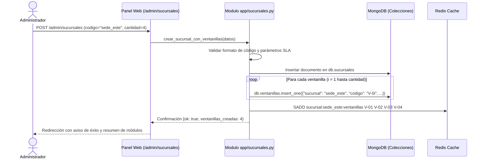

# Especificación Técnica (RFC): Mantenimiento Lógico de Sucursales y Ventanillas Parametrizables

**Documento:** RFC-004 / Arquitectura Multi-Sucursal  
**Componente:** Módulo de Administración de Sedes y Onboarding Dinámico de Capacidad  
**Responsable Técnico:** Carlos Espinoza (DBA / Persistencia MongoDB)  
**Estado:** Propuesta Técnica / En Revisión  
**Compatibilidad:** 100% retrocompatible con la arquitectura actual de QLine (Mono-sede `sede_central` / `atencion_general`)  

---

> **Nota de alcance (02/11/2026).** Este RFC es un **extra del trabajo**: no forma parte de las 29 tareas del Plan Alternativo de S4, que no prevé sucursales. **Implementado:** catálogo de sucursales (`app/sucursales.py`), pantalla `/admin/sucursales` y aprovisionamiento y ajuste de las ventanillas de cada sede, con salvaguarda contra turnos en curso y 31 pruebas automáticas junto con las de P09. **No implementado:** colas, claves de Redis, emisión, quiosco, QR ni pantalla de sala por sucursal; la operación sigue siendo de un solo servicio y de una sola sede (`atencion_general`). Las secciones de este documento que describen espacios de nombres de Redis por sucursal son una propuesta futura, no el estado actual.

---

## 1. Resumen Ejecutivo y Motivación

Actualmente, QLine opera bajo un modelo institucional de sede única centralizada (`atencion_general`) con ventanillas parametrizadas de forma global (`V-01`, `V-02`, etc.) en la colección `ventanillas` y colas lineales en Redis (`cola:atencion_general`).

El objetivo de esta especificación es plantear el **modelo arquitectónico y funcional para que un administrador del sistema pueda crear y gestionar múltiples sucursales lógicas de atención**, configurando de manera autónoma:
1. Identificación y metadatos de la sucursal (código, nombre, dirección y estado operativo).
2. Capacidad instalada: cantidad de ventanillas a aprovisionar automáticamente (por ejemplo: 5 ventanillas `V-01` .. `V-05`), tipos de servicio por módulo y prefijo identificador.
3. Objetivos de calidad específicos (SLA de espera máxima y tasa de cumplimiento requerida por sede).
4. Ciclo de vida y mantenimiento preventivo (activación, pausa operativa y desactivación con guardián de seguridad contra turnos en curso).

---

## 2. Principios de Diseño y Acoplamiento al Proyecto

Para garantizar que esta funcionalidad se acople armónicamente a la base de código existente sin romper la suite de pruebas (530 tests unitarios e integrados) ni la demostración guiada (`/demo`), se establecen los siguientes principios rectores:

1. **Principio de Compatibilidad Canónica (*Default Branch Fallback*):**  
   Se define la sucursal canónica `sede_central` (código `central`). Toda petición, script o endpoint que no reciba un parámetro explícito de `sucursal` asumirá automáticamente `central`, manteniendo intacto el comportamiento actual de emisión, llamadas y pantallas públicas.
2. **Desacoplamiento Dual Redis-MongoDB:**  
   - **MongoDB** actúa como la única fuente de verdad para el catálogo de sucursales, auditoría, esquemas BSON, estados contractuales e históricos analíticos.  
   - **Redis** aísla las estructuras de memoria volátil (listas de turnos, semáforos de ventanilla y canales Pub/Sub) mediante un espacio de nombres jerárquico prefijado por el código de la sucursal.
3. **Idempotencia y Aprovisionamiento Atómico:**  
   La creación de una sucursal con `N` ventanillas aprovisiona en una sola transacción o bloque consistente tanto el registro de la sede como sus registros hijos en la colección `ventanillas`.
4. **Protección Contra Inconsistencias Operacionales:**  
   Ninguna sucursal podrá ser desactivada, pausada o eliminada si tiene clientes en sala con turnos activos en estado `llamado` o `en_atencion`.

---

## 3. Modelo de Datos en MongoDB

### 3.1 Nueva Colección: `sucursales`

Se creará la colección `sucursales` bajo gobernanza de esquema con validador formal BSON (`$jsonSchema`).

#### Estructura Documental:
```json
{
  "_id": {"$oid": "6724a1b0f1e8a9314c810001"},
  "codigo": "central",
  "nombre": "Sede Central - San José",
  "direccion": "Avenida Segunda, Edificio Principal",
  "telefono": "+506 2222-0000",
  "estado": "activa",
  "servicios_habilitados": ["atencion_general"],
  "configuracion_ventanillas": {
    "cantidad_total": 4,
    "prefijo": "V",
    "numeracion_inicio": 1
  },
  "configuracion_sla": {
    "objetivo_max_espera_seg": 300,
    "tasa_minima_cumplimiento": 80.0
  },
  "timestamps": {
    "creado": {"$date": "2026-11-02T12:00:00.000Z"},
    "actualizado": {"$date": "2026-11-02T12:00:00.000Z"}
  },
  "metadatos": {
    "creado_por": "admin",
    "notas": "Sede central de atención institucional"
  }
}
```

#### Reglas de Validación (`$jsonSchema`):
- `codigo`: `string`, patrón regex `^[a-z0-9_-]{3,20}$` (minúsculas, guiones, alfanumérico). Índice único.
- `nombre`: `string`, longitud mínima 3, máxima 100 caracteres.
- `estado`: `string`, enumeración estricta `["activa", "inactiva", "mantenimiento"]`.
- `configuracion_ventanillas.cantidad_total`: `int`, valor mínimo 1, máximo 50.
- `configuracion_sla.objetivo_max_espera_seg`: `int`, entre 60 y 3600 segundos.

#### Índices en MongoDB:
```javascript
// Unicidad del identificador canónico de sucursal
db.sucursales.createIndex({ "codigo": 1 }, { unique: true, name: "idx_sucursales_codigo_unico" });

// Filtro de consulta para listados administrativos y selectores operativos
db.sucursales.createIndex({ "estado": 1, "nombre": 1 }, { name: "idx_sucursales_estado_nombre" });
```

---

### 3.2 Modificación Incremental en `ventanillas`

La colección `ventanillas` (introducida en P09) se enriquece agregando el campo `sucursal` para soportar múltiples recintos:

```json
{
  "_id": {"$oid": "6724a1b0f1e8a9314c810010"},
  "sucursal": "central",
  "codigo": "V-01",
  "nombre": "Ventanilla 1",
  "tipo": "general",
  "estado": "activa",
  "creado_en": {"$date": "2026-11-02T12:00:00.000Z"},
  "actualizado_en": {"$date": "2026-11-02T12:00:00.000Z"}
}
```

#### Índice Compuesto de Unicidad:
```javascript
// La ventanilla V-01 es única por sucursal, pero puede existir V-01 en sucursal 'este' y en 'oeste'
db.ventanillas.createIndex(
  { "sucursal": 1, "codigo": 1 }, 
  { unique: true, name: "idx_ventanillas_sucursal_codigo_unico" }
);
```

---

### 3.3 Modificación Incremental en `turnos`

En la colección transaccional `turnos`:
- Se agrega el campo opcional/predeterminado `"sucursal": "central"`.
- Los turnos existentes sin este campo se resuelven canónicamente hacia `"central"` mediante un valor por defecto en la capa de lectura Python (`d.get("sucursal", "central")`).

#### Índice Compuesto para Auditoría y Colas por Sucursal:
```javascript
db.turnos.createIndex(
  { "sucursal": 1, "estado": 1, "timestamps.creado": 1 }, 
  { name: "idx_turnos_sucursal_estado_creado" }
);
```

---

## 4. Jerarquía de Claves en Redis (Multi-Sucursal)

Redis gestiona el estado en caliente de las filas y la concurrencia. Para evitar colisiones entre sedes que compartan la misma instancia de Redis, se aplica un espacio de nombres jerárquico (*namespacing*):

| Función | Patrón de Clave Actual (Mono-Sede) | Patrón de Clave Multi-Sucursal | Tipo Redis | Propósito |
|---|---|---|---|---|
| **Cola de Espera** | `cola:atencion_general` | `cola:{sucursal}:{servicio}` | LIST / ZSET | IDs de turnos esperando ser llamados en esa sede |
| **Reserva de Ventanilla** | `ventanilla:atencion_general:V-01` | `ventanilla:{sucursal}:{ventanilla}` | STRING (`SET NX`) | Bloqueo atómico del turno asignado al módulo |
| **Contador Diario de Serie** | `contador:atencion_general:20261102` | `contador:{sucursal}:{servicio}:{YYYYMMDD}` | STRING (`INCR`) | Consecutivo numérico del ticket emitido por sede y día |
| **Canal Pub/Sub Pantalla** | `canal:eventos:atencion_general` | `canal:{sucursal}:eventos` | PUB/SUB | Mensajería de llamados consumida por pantalla de esa sede |
| **Relación de Ventanillas** | `ventanillas:activas` | `sucursal:{sucursal}:ventanillas` | SET | Conjunto de códigos de ventanilla habilitados en la sede |

---

## 5. Lógica de Negocio: Mantenimiento y Aprovisionamiento

### 5.1 Flujo de Creación de una Sucursal y Auto-Onboarding
Cuando el administrador envía el formulario de creación de una nueva sucursal especificando `cantidad_ventanillas`:



### 5.2 Ajuste Dinámico de Capacidad (Añadir o Remover Ventanillas)
El administrador puede cambiar la cantidad de ventanillas desde la interfaz de edición:
- **Si la nueva cantidad es mayor ($N_{nuevo} > N_{actual}$):**  
  Se generan los módulos faltantes (por ejemplo, de `V-04` se pasa a `V-06` creando `V-05` y `V-06`).
- **Si la nueva cantidad es menor ($N_{nuevo} < N_{actual}$):**  
  Se valida que las ventanillas que van a salir de servicio no tengan turnos en estado `llamado` o `en_atencion`. Si están libres, se marcan como `estado: "inactiva"` en MongoDB y se retiran del conjunto activo en Redis. Si alguna está atendiendo, la operación se rechaza con un mensaje descriptivo.

### 5.3 Regla de Seguridad para Pausar o Desactivar la Sucursal
```python
def validar_cierre_sucursal_seguro(db: Database, sucursal_codigo: str) -> None:
    """Verifica que no existan turnos en atención antes de desactivar una sucursal."""
    turnos_activos = db.turnos.count_documents({
        "sucursal": sucursal_codigo,
        "estado": {"$in": ["llamado", "en_atencion"]},
    })
    if turnos_activos > 0:
        raise SucursalError(
            f"No se puede desactivar la sucursal '{sucursal_codigo}' porque "
            f"tiene {turnos_activos} turno(s) en atención activa en ventanilla."
        )
```

---

## 6. Arquitectura de Interfaces y Endpoints

### 6.1 Endpoints de la API Administrativa

```http
# 1. Catálogo de sucursales
GET /api/admin/sucursales
Response: { "ok": true, "sucursales": [...] }

# 2. Detalle de una sucursal y sus ventanillas
GET /api/admin/sucursales/{codigo}
Response: { "ok": true, "sucursal": {...}, "ventanillas": [...] }

# 3. Creación de sucursal con auto-aprovisionamiento de ventanillas
POST /api/admin/sucursales
Content-Type: application/json
Payload:
{
  "codigo": "heredia",
  "nombre": "Sede Heredia - Centro",
  "direccion": "Costado Norte del Parque Central",
  "cantidad_ventanillas": 5,
  "prefijo_ventanilla": "V",
  "objetivo_max_espera_seg": 300,
  "tasa_minima_cumplimiento": 85.0
}
Response: { "ok": true, "accion": "creada", "codigo": "heredia", "ventanillas": 5 }

# 4. Modificación de parámetros de la sucursal
PUT /api/admin/sucursales/{codigo}
Content-Type: application/json
Payload: { "nombre": "...", "cantidad_ventanillas": 6, "estado": "activa" }

# 5. Desactivación controlada
POST /api/admin/sucursales/{codigo}/desactivar
Response: { "ok": true, "accion": "desactivada", "codigo": "heredia" }
```

### 6.2 Vistas Web en HTML / Jinja2

Se proyectan dos pantallas clave integradas al diseño sobrio y sin dependencias de QLine:

1. **Listado de Mantenimiento (`/admin/sucursales`):**  
   - Tabla administrativa de sucursales con: Código, Nombre, Dirección, Ventanillas Activas/Totales, Turnos Atendidos Hoy, Estado (badge) y Acciones (Editar, Pausar, Ver Módulos).
   - Botón superior principal: `Nueva Sucursal`.
2. **Formulario de Configuración / Creación (`/admin/sucursales/nueva` o `/admin/sucursales/{codigo}/editar`):**  
   - Campos de texto estándar para identificación.
   - Control numérico de `Cantidad de ventanillas a aprovisionar` con previsualización dinámica (`V-01`, `V-02`, ...).
   - Sliders o selectores de objetivos de calidad SLA.
   - Lista interactiva de las ventanillas generadas para renombrarlas individualmente (por ejemplo, cambiar `V-01` a "Ventanilla Preferencial / Ley 7600").

---

## 7. Contexto de Sesión y Navegación del Personal

Para que un operador o supervisor trabaje en una sucursal determinada sin requerir autenticación compleja:

1. **Selector de Sucursal en Cabecera:**  
   En la barra de navegación del personal (`app-header`), se dispone de un selector desplegable con las sucursales activas.
2. **Persistencia del Contexto:**  
   La selección se almacena en una cookie HTTP (`qline_sucursal_activa=central`) o query parameter `?sucursal=central`.
3. **Inyección en Vistas:**  
   - Al abrir `/panel`, el operador solo llama turnos de la cola `cola:{sucursal_activa}:atencion_general`.
   - La pantalla pública `/pantalla?sucursal=heredia` sintoniza exclusivamente el canal WebSocket y la lista de llamados de esa sede física.
   - El dashboard analítico `/dashboard?sucursal=heredia` filtra sus *aggregation pipelines* agregando `{"$match": {"sucursal": sucursal_seleccionada}}`.

---

## 8. Plan de Implementación por Fases

| Fase | Tareas Principales | Archivos Involucrados | Riesgo / Impacto |
|:---:|---|---|---|
| **Fase 1**<br>*(Persistencia)* | - Crear módulo [`app/sucursales.py`](../../app/sucursales.py)<br>- Funciones de inicialización y validación BSON<br>- Migración de datos existentes a `sucursal: "central"` | `app/sucursales.py`<br>`app/turnos_schema.py` | **Bajo**: La sucursal por defecto aísla los datos actuales. |
| **Fase 2**<br>*(Colas y Redis)* | - Parametrizar funciones de [`app/cola.py`](../../app/cola.py) aceptando `sucursal: str = "central"`<br>- Actualizar reservas de ventanilla con namespace | `app/cola.py`<br>`app/ventanillas.py` | **Medio**: Requiere mantener valor por defecto `"central"` en todas las firmas. |
| **Fase 3**<br>*(Rutas y UI Admin)* | - Endpoints `/admin/sucursales` y formularios<br>- Plantilla `app/templates/admin_sucursales.html`<br>- Integración al menú de administración | `app/main.py`<br>`app/templates/base.html` | **Bajo**: Nuevas pantallas independientes. |
| **Fase 4**<br>*(Pruebas Automatizadas)* | - Suite de aislamiento multi-sede<br>- Pruebas de guardián de seguridad ante turnos activos<br>- Verificación de no-regresión de los 530 tests | `tests/test_sucursales.py`<br>`tests/test_carlos_s4.py` | **Cero**: Se ejecuta en CI/CD local antes del merge. |

---

## 9. Conclusión de la Especificación

Esta especificación resuelve integralmente la necesidad de mantenimiento lógico de sedes planteada por el usuario. Su diseño:
- **Respeta la gobernanza de esquema en MongoDB** y aprovecha índices compuestos para garantizar búsquedas `IXSCAN` inmediatas por sucursal.
- **Parametriza limpiamente las claves de Redis** evitando mezcla de colas o eventos en sala.
- **Ofrece un mantenimiento intuitivo para el administrador**, permitiendo aprovisionar de 1 a 50 módulos en segundos con auto-generación de códigos.
- **Garantiza compatibilidad total**: el sistema actual continúa funcionando exactamente igual bajo el código de sede `central`.
