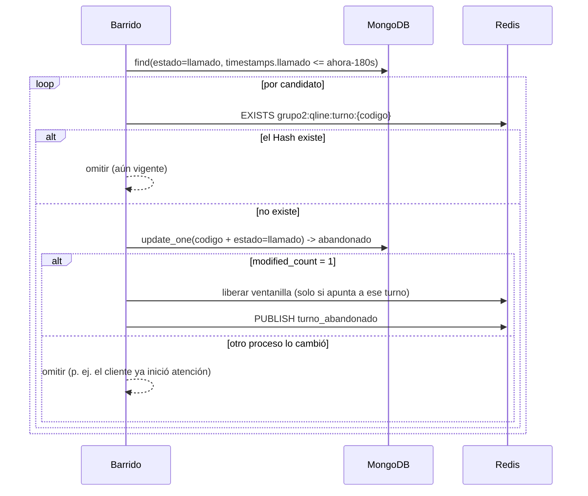

# Diseño técnico · S3 · HU-008 y HU-012

**Responsable:** Abigail Urbina / `aurbina`
**Estado:** implementado e integrado (ver `docs/seguimientos/S3.md`, sección 5, y `docs/decisiones.md`, D-16 a D-21). Este documento conserva el diseño original; donde difiere, manda `decisiones.md`.

## 1. Principio
> MongoDB conserva lo que ocurrió. Redis controla lo que ocurre ahora.

- **Abandono:** Redis sabe cuándo venció el plazo (Hash con TTL); MongoDB guarda el resultado histórico.
- **Recuperación:** si Redis pierde el estado, MongoDB tiene todo lo necesario para reconstruir la cola.

---

## 2. HU-008 · Barrido de abandono

### 2.1 Por qué un barrido
Redis no avisa cuando una clave expira (no se puede usar `CONFIG SET` para notificaciones). Por eso, según el contrato con Alessandro, un turno llamado es candidato a abandono cuando:

```
timestamps.llamado + 180 s ya pasó   Y   el Hash grupo2:qline:turno:{codigo} ya no existe
```
Un barrido periódico (cada 10 s por defecto) revisa los turnos `llamado`.

### 2.2 Flujo por candidato


### 2.3 Garantías
| Riesgo | Cómo se evita |
|---|---|
| El cliente se presenta justo cuando vence | El cambio es `update_one` con filtro `estado = llamado`: si HU-006 ya lo pasó a `en_atencion`, no coincide y no se abandona |
| Dos workers barren a la vez | Solo uno obtiene `modified_count = 1`; liberar y publicar son idempotentes |
| Redis no responde | No se abandona (no se puede verificar el Hash); se informa en `omitidos_redis` y la siguiente pasada lo resuelve |
| MongoDB cae a mitad | Se detiene la pasada, lo ya abandonado queda registrado, el resto se reintenta |
| Falla liberar la ventanilla | MongoDB queda correcto; se reintenta 1 vez y se informa en `errores_liberar` |
| Falla publicar el evento | No revierte MongoDB; se informa en `errores_evento` |
| Liberar la ventanilla equivocada | Liberación atómica «solo si el valor es ese turno» (Lua `GET`/`DEL`) |

### 2.4 Qué se escribe en MongoDB
Solo `estado = abandonado` y `timestamps.abandonado`. La `ventanilla` se conserva (historial). Sin campos nuevos.

`timestamps.abandonado = timestamps.llamado + 180 s` (el instante en que venció el TTL), **no** la hora del barrido; así la métrica no depende de la frecuencia del barrido y es coherente con los datos de TT-005 (ver decisión D-S3-A1).

### 2.4.1 Periodicidad
`BarridoPeriodico` es un hilo daemon por proceso (mismo patrón que el receptor de eventos). `intervalo_seg` por defecto 10 s: el abandono se refleja como máximo ~10 s después de vencer el TTL.

---

## 3. HU-012 · Rehidratación (reconciliación)

### 3.1 Enfoque: reconciliar, no «borrar y reconstruir»
`reconciliar_cola` compara MongoDB con Redis y corrige solo la diferencia. Es idempotente y sirve para:
- pérdida total (cola vacía);
- pérdida parcial;
- el caso abierto de S3: turno extraído de la cola y no confirmado en MongoDB (sigue `pendiente`, fuera de la cola).

No se vacía la cola antes de reconstruir: habría una ventana en que la cola está vacía con tráfico real, y la tarea no debe usar `FLUSHALL` / `FLUSHDB`.

### 3.2 Algoritmo
```
1. pendientes = MongoDB: servicio=atencion_general, estado=pendiente
2. ordenar por (prioridad: preferencial < normal, creado, código)      -> esperados
3. en_cola = leer_cola()                                               (sin remover)
4. faltantes = esperados - en_cola
5. sobrantes = en_cola - esperados   (no pendientes en MongoDB: atendido, abandonado, huérfanos…)
6. encolar(faltantes) en orden, con la función de Alessandro
7. contador: si contador_Redis < mayor consecutivo A-NNN de MongoDB -> subirlo (nunca bajarlo)
8. verificar: 100 % de esperados presentes, 0 duplicados, orden correcto, sin sobrantes
```
Si una lectura inicial falla (MongoDB o Redis), se lanza un error controlado y **no se modifica nada**.

### 3.3 Reglas de los criterios
| Criterio | Cómo se cumple |
|---|---|
| Solo pendientes | Consulta `estado = pendiente`; llamado, en atención, atendido y abandonado nunca se encolan |
| Prioridad y llegada | Orden `(RANGO_PRIORIDAD, creado, codigo)`; luego se verifica el orden resultante |
| Sin duplicados | Solo se encola lo que falta; verificación de repetidos en la cola final |
| Antes/después | `ReporteRecuperacion` guarda cola antes, esperados, encolados y cola después |
| 100 % recuperado | `recuperados_pct` sobre los esperados |

### 3.4 Hallazgo: el contador de códigos
El contador `grupo2:qline:contador:atencion_general` también vive en Redis. Si se pierde, `INCR` vuelve a empezar en 1 y la emisión generaría códigos que **ya existen en MongoDB** (`codigo` es único): duplicados o errores. Por eso la recuperación restaura el contador al mayor consecutivo `A-NNN` de MongoDB, **solo subiéndolo** (`SET` condicional atómico en Lua), para no pisar emisiones recientes.
> Supuesto a confirmar con Alessandro: los códigos son `A-NNN` y el contador coincide con el número.

### 3.5 Qué hace con cada situación
| Situación | Resultado |
|---|---|
| Sobrante: turno `atendido`/`abandonado` en la cola | Se informa; `ok = false`; con `--quitar-sobrantes` se saca (estado inválido §17) |
| Código en la cola que no existe en MongoDB | Advertencia; se trata como sobrante |
| Pendiente con prioridad inválida o sin `creado` | No se encola; se informa en `invalidos` |
| Redis cae a mitad | `ok = false` con errores; repetir completa lo que falta, sin duplicar |
| Turno `llamado` cuyo Hash se perdió | No vuelve a la cola; el barrido lo abandona al vencer los 180 s (equivale al TTL) |

### 3.6 Seguridad en el servidor compartido
- Sin `FLUSHALL` / `FLUSHDB`; solo claves `grupo2:qline:`.
- La prueba (TT-017) limita la pérdida simulada a los códigos `R-*`.
- Un reinicio total de Redis no se provoca en el servidor del curso: afectaría a otros grupos.

---

## 4. Integración con el código de Alessandro
`app/abandono.py` y `app/recuperacion.py` **no importan** `app/cola.py`: reciben funciones.

| Función requerida | Viene de | Estado |
|---|---|---|
| `hash_existe`, `liberar_ventanilla` | Contrato §5.2 (implementadas en `integracion_s3.py`) | Listas; validar nombres de clave con Alessandro |
| `publicar_evento` | `app/eventos.py` | **Adaptar** (formato del mensaje) |
| `leer_cola`, `encolar`, `quitar` | `app/cola.py` | **Adaptar** (miembro y score) |
| `leer_contador`, `fijar_contador` | Contrato §5.2 | Listas |

Ventaja: se garantiza el mismo miembro y el mismo score que usa la emisión, sin duplicar una fórmula que no es tuya.

## 5. Archivos
| Archivo | Responsabilidad |
|---|---|
| `app/s3_comun.py` | Reexporta las constantes de `app/constantes.py`; errores y utilidades de fecha |
| `app/abandono.py` | `barrer_abandonos` (HU-008) |
| `app/barrido.py` | `BarridoPeriodico` (hilo) |
| `app/recuperacion.py` | `reconciliar_cola`, `ReporteRecuperacion` (HU-012) |
| `app/prueba_recuperacion.py` | Escenario de TT-017 |
| `app/mediciones_s3.py` | Mediciones de TT-018 |
| `app/integracion_s3.py` | Enlace con MongoDB/Redis reales y arranque del barrido |
| `app/datos_prueba.py`, `app/informe.py` | Turnos de prueba coherentes y encabezado común de los informes |
| `app/fallos_s3.py` | Casos de fallo de TT-019 |
| `scripts/*.py` | `barrer_abandonos`, `rehidratar_cola`, `probar_recuperacion`, `medir_recuperacion` |

## 6. Decisiones abiertas
Resueltas: ver `docs/decisiones.md` (D-16 a D-21).
