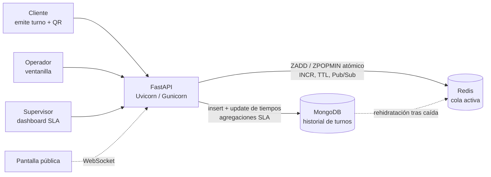

# QLine

**Sistema inteligente de gestión de filas y turnos en tiempo real**

> *"MongoDB conserva lo que ocurrió. Redis controla lo que ocurre ahora."*

Proyecto final de **Tópicos Avanzados de Bases de Datos** · Universidad Nacional · Equipo **Query Logic**


---

## 1. Problema

En clínicas, municipalidades, bancos y cooperativas, las salas de espera se colapsan y el orden se pierde en los pasillos. Cuando varias ventanillas atienden a la vez existe un riesgo operativo real: **dos operadores en ventanillas distintas pueden llamar al mismo turno simultáneamente**, y nadie conserva un historial confiable para medir si se cumplen los tiempos de servicio (SLA).

**QLine** coordina múltiples ventanillas de atención simultánea garantizando **cero turnos duplicados** mediante concurrencia atómica, y conserva la trazabilidad histórica para medir los SLA.

## 2. Usuarios

| Actor | Qué hace en QLine |
|---|---|
| **Cliente / paciente** | Genera su turno (con QR) eligiendo prioridad y monitorea su posición en la sala. |
| **Operador de ventanilla** | Pulsa "Llamar siguiente" de forma atómica, inicia y finaliza la atención. |
| **Supervisor** | Ve en vivo los tiempos de espera y audita el cumplimiento del SLA. |

## 3. Alcance del MVP (2–3 semanas)

**Entra**

- Emisión web de turnos con selección de prioridad (normal / preferencial).
- Cola activa en memoria con asignación atómica en Redis.
- Panel de ventanilla: *Llamar*, *Iniciar*, *Finalizar* atención.
- Historial persistente en MongoDB y dashboard básico de SLA.
- Pantalla pública con el turno llamado.

**No entra (fuera de alcance)**

- Aplicaciones móviles nativas.
- Notificaciones por WhatsApp o SMS.
- Pasarelas de pago.
- Múltiples sucursales complejas.

## 4. Arquitectura (v1)

Dos motores con responsabilidades separadas:

| Motor | Responsabilidad | Qué vive ahí |
|---|---|---|
| **Redis** (lo que ocurre *ahora*) | Concurrencia, cola y TTL | Cola de turnos en espera con prioridad, contador de códigos, turno en atención por ventanilla, expiración por abandono. |
| **MongoDB** (lo que *ocurrió*) | Persistencia y métricas | Colección inmutable `turnos` con marcas de tiempo y métricas de SLA. |



> El diagrama completo irá en `docs/arquitectura/`.

### Decisiones clave

- **Cola con prioridades:** *sorted set* de Redis (`ZADD` / `ZPOPMIN`). `ZPOPMIN` es atómico, por lo que dos ventanillas nunca reciben el mismo turno.
- **Código de turno** (`A-015`): generado con `INCR`, también atómico.
- **Tiempo real:** cada cambio se publica en un canal Redis Pub/Sub y FastAPI lo reenvía por WebSocket a la pantalla pública y al cliente.
- **Abandono:** un turno llamado y sin respuesta expira a los 180 s (clave con TTL).
- **Resiliencia:** si Redis se cae, MongoDB conserva los turnos pendientes; al reanudar, un proceso **rehidrata** la cola sin pérdida de datos. Redis se configura además con AOF.

## 5. Modelo de datos (v1)

### MongoDB · colección `turnos` (inmutable salvo tiempos y métricas)

```json
{
  "codigo": "A-015",
  "servicio": "Cajas",
  "prioridad": "preferencial",
  "estado": "atendido",
  "ventanilla": "V-02",
  "operador": "Carlos M.",
  "timestamps": { "creado": "09:12Z", "llamado": "09:18Z", "finalizado": "09:23Z" },
  "metricas": { "espera_seg": 382, "atencion_seg": 323 }
}
```

Estados: `pendiente` → `llamado` → `en_atencion` → `atendido` · `abandonado`.

### Redis · claves

| Clave | Tipo | Uso |
|---|---|---|
| `cola:{servicio}` | Sorted set | Turnos en espera. Score = prioridad + hora de llegada. |
| `contador:{servicio}` | String | `INCR` para el número consecutivo del código. |
| `ventanilla:{id}:actual` | String | Turno que atiende cada ventanilla. |
| `turno:{codigo}` | Hash + TTL | Datos del turno llamado; expira a los 180 s si no se presenta. |
| `eventos` | Pub/Sub | Cambios de estado hacia las pantallas en vivo. |

## 6. Evidencias técnicas que validará el MVP

| Evidencia | Meta |
|---|---|
| **Concurrencia** | 10 ventanillas llamando al unísono → **0 turnos duplicados**. |
| **Rendimiento** | Latencia en Redis < 2 ms frente a MongoDB (> 85 % de aceleración). |
| **Recuperación** | 100 % de los turnos restaurados tras reiniciar Redis forzosamente. |

## 7. Fuente de datos

Generador **sintético** de turnos (`scripts/`): crea clientes, servicios y prioridades con distribución de llegadas configurable, para las pruebas de carga y el dashboard de SLA.

## 8. Estado actual (Seguimiento 1)

Lo logrado hasta ahora es la base técnica sobre la que se construirá QLine: una aplicación **FastAPI + MongoDB** que ya se conecta al motor, con CRUD completo de colecciones y documentos.

- [x] Stack definido: FastAPI, PyMongo, Redis (`redis-py`), Jinja2.
- [x] Aplicación "Hola mundo" conectada a **MongoDB** (listar/crear colecciones, insertar, editar y eliminar documentos).
- [x] Despliegue en servidor Apache con proxy inverso a Uvicorn, protegido con autenticación básica.
- [x] Configuración por variables de entorno (`.env`), sin credenciales en el código.
- [ ] Conexión a **Redis** desde la aplicación (pendiente: instalación en el servidor).
- [ ] Cola de turnos, emisión y panel de ventanilla.
- [ ] Pruebas de concurrencia y rehidratación.

## 9. Estructura del repositorio

```
QLine/
├── app/
│   ├── main.py              # rutas FastAPI (hola mundo MongoDB)
│   └── templates/
│       └── index.html
├── static/
│   └── style.css
├── docs/
│   ├── arquitectura/        # diagrama de arquitectura v1
│   └── seguimientos/
│       └── S1.md            # bitácora del Seguimiento 1
├── scripts/                 # generador de datos y pruebas de carga
├── data/                    # datos de ejemplo
├── requirements.txt
├── .env.example
├── qline.service            # unidad systemd (si hay acceso root)
├── .gitignore
├── LICENSE                  # MIT
└── README.md
```

## 10. Instalación y ejecución

**Requisitos:** Python 3.9 o superior, MongoDB accesible y, para las siguientes etapas, Redis.

```bash
git clone https://github.com/<organizacion>/QLine.git
cd QLine

python3 -m venv venv           # o: uv venv venv
source venv/bin/activate
pip install -r requirements.txt   # o: uv pip install --python venv/bin/python -r requirements.txt

cp .env.example .env           # completar credenciales
chmod 600 .env

uvicorn app.main:app --host 127.0.0.1 --port 8000
```

Abrir `http://127.0.0.1:8000`.

### Variables de entorno

| Variable | Descripción | Ejemplo |
|---|---|---|
| `MONGO_USER` / `MONGO_PASS` | Credenciales de MongoDB | `grupo2` / *(secreto)* |
| `MONGO_DB` | Base de datos | `grupo2_db` |
| `MONGO_HOST` / `MONGO_PORT` | Servidor MongoDB | `127.0.0.1` / `27017` |
| `REDIS_HOST` / `REDIS_PORT` / `REDIS_PASS` | Servidor Redis (etapas siguientes) | `127.0.0.1` / `6379` |
| `BASE_PATH` | Prefijo público si se publica en una subruta | `/proyecto/qline` |

> **Nunca** subas el archivo `.env` al repositorio. Está en `.gitignore`.

### Despliegue en servidor compartido (Apache)

La aplicación escucha solo en `127.0.0.1` y Apache la publica con un `.htaccess` que reenvía las peticiones al puerto de Uvicorn, protegido con autenticación básica. Con acceso root se recomienda `qline.service` (systemd) y Gunicorn con workers Uvicorn.

## 11. Hoja de ruta

| Seguimiento | Entregable |
|---|---|
| **S1** (actual) | Problema, arquitectura v1, modelo de datos, repositorio y "Hola mundo" con el motor. |
| **S2** | Redis: cola con `ZPOPMIN`, emisión de turnos y panel de ventanilla. |
| **S3** | Tiempo real (WebSocket), historial en MongoDB y dashboard de SLA. |
| **Final** | Pruebas de concurrencia, rendimiento y recuperación; documentación. |


## 12. Equipo

| Integrante | Rol |
|---|---|
| Alessandro Cambronero Delgado | Desarrollador |
| Abigail Urbina Gómez | Desarrolladora |
| Carlos Espinoza Pérez | Desarrollador |
| Aaron Benavides Vega | Desarrollador |

## 14. Licencia

Distribuido bajo licencia **MIT**. Ver [`LICENSE`](../../LICENSE).
